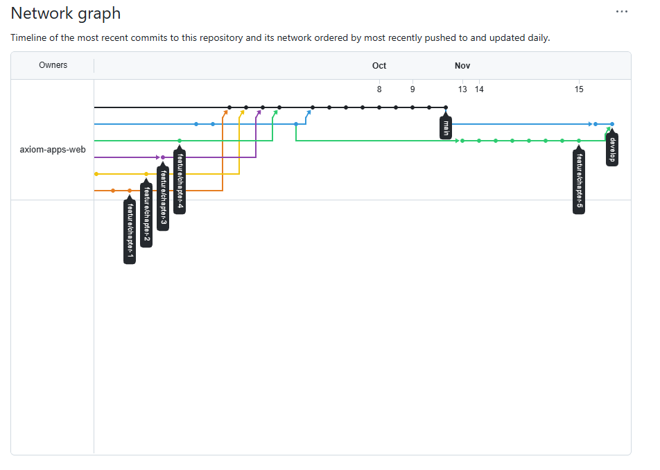
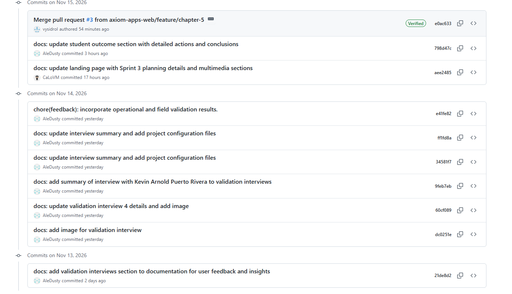

# Project Report Collaboration Insights

- URL del repositorio para el reporte del proyecto: [https://github.com/axiom-apps-web/tourmate-report](https://github.com/axiom-apps-web/tourmate-report)
- URL del repositorio para la Landing Page: [https://github.com/axiom-apps-web/tourmate-landing](https://github.com/axiom-apps-web/tourmate-landing)
- URL del repositorio para la Web Application: [https://github.com/axiom-apps-web/tourmate-web-application](https://github.com/axiom-apps-web/tourmate-web-application)
- URL del repositorio para los Web Services: [https://github.com/axiom-apps-web/tourmate-platform](https://github.com/axiom-apps-web/tourmate-platform)

**AV1**

Para el desarrollo del informe perteneciente a la entrega AV1, se dividió la implementación de secciones de la siguiente forma para cada integrante del equipo:

| Integrante       | Tareas Asignadas                                                                                                                                                                           |
| ---------------- | ------------------------------------------------------------------------------------------------------------------------------------------------------------------------------------------ |
| Segura Guerra, Alison Ariana | Desarrollo del Capítulo I y del Capítulo II en formato markdown.                                                             |
| Ysidro Llashag, Valeria Milagros     | Desarrollo del Capítulo III, parte del capítulo IV en formato markdown.                                                  |
| Molina Vasquez, Manuel Alejandro      | Desarrollo del Capítulo IV enfocado en desarrollo de UX/UI Design.                                                                               |
| Carrillo Acho, Matias Renato  | Desarrollo del Capítulo IV enfocado en system design, así como colaboración en el capítulo V del documento en formato markdown.                                                                               |
| Verastigue Martinez, Giancarlo Jose  | Desarrollo del Capítulo V, despliegue de Landing Page |

El trabajo se desarrolló mediante commits continuos en el repositorio de la organización, asegurando trazabilidad y colaboración activa del equipo.

**TB1**

Para el desarrollo del informe perteneciente a la entrega TB1, se dividió la implementación de secciones de la siguiente forma para cada integrante del equipo:

| Integrante       | Tareas Asignadas                                                                                                                                                                           |
| ---------------- | ------------------------------------------------------------------------------------------------------------------------------------------------------------------------------------------ |
| Segura Guerra, Alison Ariana | Desarrollo del Capítulo I y del Capítulo II en formato markdown.                                                             |
| Ysidro Llashag, Valeria Milagros     | Desarrollo del Capítulo 5.2.1, parte del capítulo IV en formato markdown.                                                  |
| Molina Vasquez, Manuel Alejandro      | Desarrollo del Capítulo 5.2.2                                                                                |
| Carrillo Acho, Matias Renato  | Desarrollo del Capítulo 5.2.3                                                                               |
| Verastigue Martinez, Giancarlo Jose  | 5.2.6 |

El trabajo se desarrolló mediante commits continuos en el repositorio de la organización, asegurando trazabilidad y colaboración activa del equipo.

**AV2**

Para el desarrollo del informe perteneciente a la entrega AV2, se dividió la implementación de secciones de la siguiente forma para cada integrante del equipo:

| Integrante       | Tareas Asignadas                                                                                                                                                                           |
| ---------------- | ------------------------------------------------------------------------------------------------------------------------------------------------------------------------------------------ |
| Segura Guerra, Alison Ariana | Desarrollo de la sección 5.2.3.5  y video demostrativo del Sprint 3. Bounded context Subscriptions and Payment Management en la Web Application y los Web Services. |
| Ysidro Llashag, Valeria Milagros     | Desarrollo de la sección 5.2.3.6. Bounded context Feedback and Tour Reviews en los Web Services. |
| Molina Vasquez, Manuel Alejandro      | Desarrollo de las entrevistas de validación; corrección de URL e imágenes. Bounded context Safety and Incident Management en la Web Application y los Web Services. |
| Carrillo Acho, Matias Renato  | Bounded context Tour Management en los Web Services. |
| Verastigue Martinez, Giancarlo Jose  | Desarrollo de la sección 5.2.3 del capítulo V. Estructura inicial de los Web Services, bounded contexts IAM y Tour Monitoring, e integración de ramas. |

El trabajo se desarrolló mediante commits continuos en el repositorio de la organización, asegurando trazabilidad y colaboración activa del equipo. A continuación, se muestran las evidencias de colaboración en el repositorio del informe durante esta entrega:

*Gráfico de ramas (Network) del repositorio tourmate-report durante la entrega AV2.*

*Historial de commits de la rama develop del repositorio tourmate-report durante la entrega AV2.*
---

