### 5.2.1. Sprint 1

#### *5.2.1.1. Sprint Planning 1*

Para el desarrollo del primer sprint nos centramos en el desarrollo de la landing page de nuestra aplicación. Para ello designamos tareas específicas para cada sección, de modo que podamos repartirnos estas tareas entre los integrantes del grupo por sección de la landing, agilizando su desarrollo. Dentro de la landing se presenta quienes somos, funcionalidades, planes, manera de contactarnos y sobre la organización.

| **Sprint #** | 1                                                                                                                                                                                                                                        |
| --- |------------------------------------------------------------------------------------------------------------------------------------------------------------------------------------------------------------------------------------------|
| **Sprint Planning Background** |                                                                                                                                                                                                                                          |
| **Date** | 2026-09-10                                                                                                                                                                                                                               |
| **Time** | 4:00 PM                                                                                                                                                                                                                                  |
| **Location** | Reunión virtual                                                                                                                                                                                                                          |
| **Prepared By** | Giancarlo Verastigue Martinez                                                                                                                                                                                                            |
| **Attendees** | Giancarlo Verastigue Martinez, Matias Carrillo Acho, Valeria Milagros Ysidro Llashag, Manuel Alejandro Molina Vasquez, Alison Ariana Segura Guerra                                                                                                                                                                     |
| **Sprint n – 1 Review Summary** | N/A (Primer Sprint del proyecto. Se establecieron las bases de la arquitectura, infraestructura en la nube y repositorios).                                                                                                              |
| **Sprint n – 1 Retrospective Summary** | N/A (Primer Sprint. El equipo acordó usar GitFlow y Conventional Commits rigurosamente desde el primer día).                                                                                                                             |
| **Sprint Goal & User Stories** |                                                                                                                                                                                                                                          |
| **Sprint 1 Goal** | Our focus is on delivering a fast, static Landing Page (HTML/CSS/JS) with language support to attract clients and validate our value proposition. This will be confirmed when the Landing Page is deployed and fully navigable by users. |
| **Sprint 1 Velocity** | 10 Story Points (Velocidad estimada para el primer ciclo del equipo).                                                                                                                                                                    |
| **Sum of Story Points** | 10                                                                                                                                                                                                                                       |

#### *5.2.1.2. Aspect Leaders and Collaborators*

A continuación se detalla la matriz de liderazgo y colaboración (LACX) para brindar claridad en la comunicación del equipo durante el desarrollo de las tareas de este Sprint.

| Team Member (Last Name, First Name) | GitHub Username | Landing Page UI/UX | Landing Page Structure | Basic Funcs | Special Funcs |
|-------------------------------------|-----------------| --- | --- | --- | --- |
| Verastigue Martinez, Giancarlo      | @CaLoVM         | C | L | C | C |
| Carrillo Acho, Matias               | @lonybreux      | C | C | C | L |
| Ysidro Llashag, Valeria Milagros         | @vysidrol      | C | C | L | C |
| Molina Vasquez, Manuel Alejandro    | @AleDusty       | C | C | L | C |
| Segura Guerra, Alison Ariana     | @Nox010111  | L | C | C | C |

#### *5.2.1.3. Sprint Backlog 1*

El objetivo principal de este Sprint es desarrollar el sitio web estático (Landing Page) de TourMate, encargado de comunicar la propuesta de valor de la plataforma a los dos segmentos objetivo: turistas y agencias. Durante este Sprint se implementarán las secciones de contenido principal, navegación, beneficios diferenciados por segmento, funcionalidades del producto, testimonios, información del equipo y el formulario de contacto, además de los flujos de acceso al registro y el manejo de estados de error/no disponibilidad definidos en las User Stories asociadas a EP06.

**Trello link:** [https://trello.com/b/gCKcMjVR/tourmate-sprint-1](https://trello.com/b/gCKcMjVR/tourmate-sprint-1)

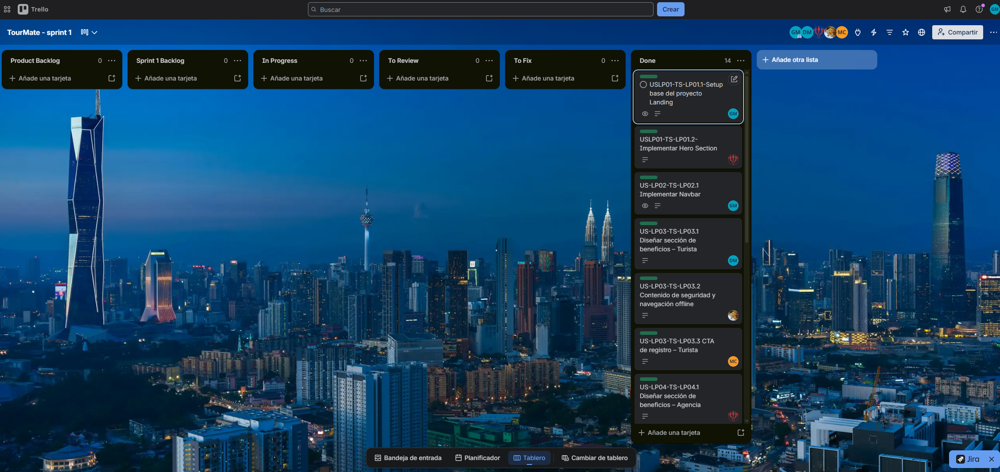
## Sprint 1

| User Story Id | User Story Title | Work-Item / Task Id | Work-Item / Task Title | Description                                                                                    | Estimation (Hours) | Assigned To | Status |
| --- | --- |---------------------| --- |------------------------------------------------------------------------------------------------| --- | --- |--------|
| US-LP01 | Conocer la propuesta de valor | TS-LP01.1           | Setup base del proyecto Landing | Inicializar el repositorio con la estructura base HTML5/CSS para la Landing Page.              | 2 | @lonybreux | Done   |
| US-LP01 | Conocer la propuesta de valor | TS-LP01.2           | Implementar Hero Section | Desarrollar la sección principal con el propósito y beneficio central de TourMate.             | 4 | @lonybreux | Done  |
| US-LP02 | Navegar entre secciones | TS-LP02.1           | Implementar Navbar | Crear el componente de navegación con enlaces a cada sección de la Landing.                    | 2 | @vysidrol | Done  |
| US-LP03 | Conocer beneficios para turistas | TS-LP03.1           | Diseñar sección de beneficios – Turista | Maquetar la sección con los beneficios orientados al segmento turista.                         | 3 | @Nox010111 | Done  |
| US-LP03 | Conocer beneficios para turistas | TS-LP03.2           | Contenido de seguridad y navegación offline | Redactar e integrar el contenido sobre funcionalidades de seguridad y modo offline.            | 2 | @lonybreux | Done  |
| US-LP03 | Conocer beneficios para turistas | TS-LP03.3           | CTA de registro – Turista | Implementar botón que redirige al proceso de registro del segmento turista.                    | 1 | @CaLoVM | Done  |
| US-LP04 | Conocer beneficios para agencias | TS-LP04.1           | Diseñar sección de beneficios – Agencia | Maquetar la sección con los beneficios orientados al segmento agencia.                         | 3 | @vysidrol | Done  |
| US-LP04 | Conocer beneficios para agencias | TS-LP04.2           | Contenido de monitoreo, alertas y gestión | Redactar e integrar el contenido sobre funcionalidades de monitoreo y gestión de expediciones. | 2 | @vysidrol | Done  |
| US-LP04 | Conocer beneficios para agencias | TS-LP04.3           | CTA de registro – Agencia | Implementar botón que redirige al proceso de registro del segmento agencia.                    | 1 | @AleDusty | Done  |
| US-LP05 | Conocer las funcionalidades principales | TS-LP05.1           | Sección de funcionalidades principales | Desarrollar grid/cards con las funcionalidades clave de TourMate.                              | 3 | @AleDusty | Done  |
| US-LP05 | Conocer las funcionalidades principales | TS-LP05.2           | Contenido de operatividad offline | Integrar contenido claro sobre la compatibilidad y uso sin conexión.                           | 2 | @Nox010111 | Done  |
| US-LP08 | Contactar al equipo de Tourmate | TS-LP08.1           | Formulario de contacto | Maquetar el formulario de contacto con los campos requeridos.                                  | 3 | @vysidrol | Done  |
| US-LP08 | Contactar al equipo de Tourmate | TS-LP08.2           | Endpoint de envío de mensaje | Implementar el servicio que registra el mensaje y retorna confirmación de recepción.           | 4 | @Nox010111 | Done  |
| US-LP09 | Conocer al equipo de la startup | TS-LP09.1           | Sección "Sobre el equipo" | Maquetar la sección con la información de los miembros de Axiom.                               | 2 | @CaLoVM | Done  |

#### *5.2.1.4. Development Evidence for Sprint Review*

En la siguiente tabla se resumen los principales commits realizados en los repositorios de Axiom correspondientes al alcance del primer Sprint, aplicando Conventional Commits.

| Repository | Branch | Commit Id | Commit Message | Commit Message Body | Committed on |
|---|---|---|---|---|---|
| axiom/tourmate-landing | main | 76bcf2e | fix: update font families and improve section structure in index.html and styles.css | Actualiza las fuentes tipográficas y mejora la estructura de secciones en index.html y styles.css. | 2026-09-20 |
| axiom/tourmate-landing | main | a23d975 | fix(i18n): correct spelling and punctuation in translation files | Corrige errores de ortografía y puntuación en los archivos de traducción. | 2026-09-20 |
| axiom/tourmate-landing | develop | 9811fb3 | Merge branch 'main'  into develop | Integra los cambios de la rama main del repositorio remoto hacia develop. | 2026-09-20 |
| axiom/tourmate-landing | develop | b245be9 | Merge branch 'feature/vision-section' into develop | Integra la rama de la sección de visión en la rama develop. | 2026-09-20 |
| axiom/tourmate-landing | feature/vision-section | 014de80 | feat(vision): add vision section with responsive design and styling | Añade la sección de visión con diseño adaptativo y estilos. | 2026-09-20 |
| axiom/tourmate-landing | main | 42529af | Update visitor.js | Actualiza el archivo visitor.js. | 2026-09-20 |
| axiom/tourmate-landing | main | 83e13b1 | Update visitor.js | Actualiza el archivo visitor.js. | 2026-09-20 |
| axiom/tourmate-landing | main | be68dc6 | Update visitor.js | Actualiza el archivo visitor.js. | 2026-09-20 |
| axiom/tourmate-landing | main | 736eb84 | Update main.js | Actualiza el archivo main.js. | 2026-09-20 |
| axiom/tourmate-landing | main | 6406282 | Update main.js | Actualiza el archivo main.js. | 2026-09-20 |
| axiom/tourmate-landing | main | 6e86319 | Update main.js | Actualiza el archivo main.js. | 2026-09-20 |
| axiom/tourmate-landing | main | daa7af6 | Merge pull request #1 from axiom-apps-web/develop | Integra el pull request #1 desde la rama develop. | 2026-09-19 |
| axiom/tourmate-landing | feature/i18n | b092f7c | feat(i18n): update language switching funcionality | Actualiza la funcionalidad de cambio de idioma. | 2026-09-19 |
| axiom/tourmate-landing | feature/i18n | 999267c | feat(i18n): add Spanish team translations | Añade las traducciones al español para la sección del equipo. | 2026-09-19 |
| axiom/tourmate-landing | feature/i18n | 76214cb | feat(i18n): add English team translations | Añade las traducciones al inglés para la sección del equipo. | 2026-09-19 |
| axiom/tourmate-landing | feature/inicio-section | cb864bf | feat: add inicio section | Implementa la sección de inicio. | 2026-09-19 |
| axiom/tourmate-landing | main | 71caea9 | feat(assets): add images | Añade imágenes a los recursos del proyecto. | 2026-09-19 |
| axiom/tourmate-landing | feature/agencias-viajeros-section | 34c2ed9 | feat: add agencias and viajeros section | Implementa las secciones de agencias y viajeros. | 2026-09-19 |
| axiom/tourmate-landing | develop | e5ead30 | Merge branch 'feature/agencias-viajeros-section' into develop | Integra la rama de la sección de agencias y viajeros en develop. | 2026-09-19 |
| axiom/tourmate-landing | feature/vision-section | 05b8c86 | feat: add vision section | Implementa la estructura base de la sección de visión. | 2026-09-19 |
| axiom/tourmate-landing | feature/inicio-section | a3cfdbb | feat(assets): add hero expedition image | Agrega la imagen hero expedition a los recursos del proyecto. | 2026-09-19 |
| axiom/tourmate-landing | feature/i18n | 0f66705 | feat(i18n): add English translations for agencies, travelers, and modal sections | Agrega traducciones al inglés para las secciones de agencias, viajeros y modales. | 2026-09-19 |
| axiom/tourmate-landing | feature/i18n | a9e4d5f | feat(i18n): add Spanish translations for agencies, travelers, and modal sections | Agrega traducciones al español para las secciones de agencias, viajeros y modales. | 2026-09-19 |
| axiom/tourmate-landing | feature/i18n | 3df7e6d | feat(i18n): add unified bilingual support and modal integration | Añade soporte bilingüe unificado e integración de modales. | 2026-09-19 |
| axiom/tourmate-landing | feature/agencias-viajeros-section | cd2cd16 | feat(index): add bilingual sections for agencies and travelers | Añade las secciones bilingües de agencias y viajeros en el index. | 2026-09-19 |
| axiom/tourmate-landing | main | 0210cd0 | feat(assets): implementation of modal B2B | Implementa los recursos visuales para el modal B2B. | 2026-09-19 |
| axiom/tourmate-landing | main | d7bc437 | add .gitignore to exclude default and editor-specific files | Agrega el archivo .gitignore para excluir archivos por defecto y del editor. | 2026-09-19 |
| axiom/tourmate-landing | feature/contact-footer | a5fcae8 | add styles for navbar, footer, and responsive design | Añade estilos para la barra de navegación, el pie de página y diseño responsivo. | 2026-09-19 |
| axiom/tourmate-landing | feature/contact-footer | 5ae9dc4 | add contact and footer sections to index.html | Agrega las secciones de contacto y pie de página en el archivo index.html. | 2026-09-19 |
| axiom/tourmate-landing | main | 289fbe5 | add initial structure | Agrega la estructura inicial del proyecto. | 2026-09-18 |
| axiom/tourmate-landing | main | a1747aa | Initial commit | Commit inicial del repositorio. | 2026-09-09 |

#### *5.2.1.5. Execution Evidence for Sprint Review*

Durante este Sprint, el equipo logró implementar la versión inicial del Landing Page funcional, rápido y estático, incluido el sistema de idiomas.

*Figura  (Landing Page)*
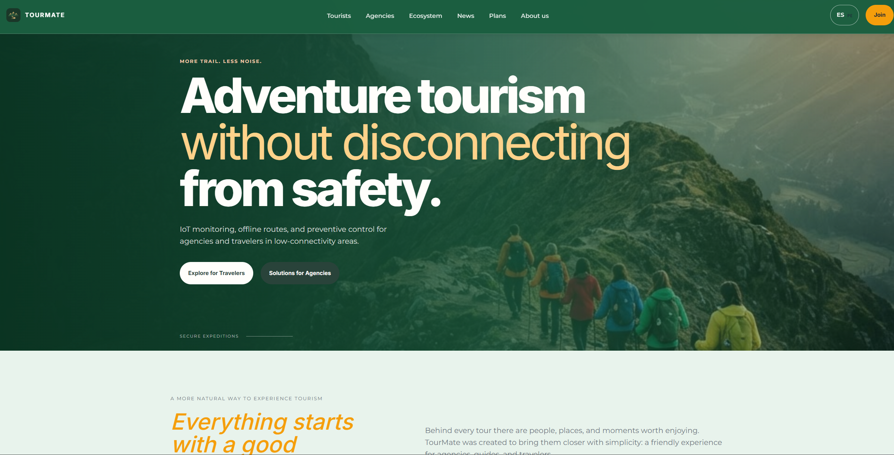

**Landing Page Demonstration Video:** [https://upcedupe-my.sharepoint.com/:v:/g/personal/u202419483_upc_edu_pe/IQDPy8lARpAQRp4FrzFWEwqxAe1KOWcMdKkZwhyLW45DKmo?nav=eyJyZWZlcnJhbEluZm8iOnsicmVmZXJyYWxBcHAiOiJPbmVEcml2ZUZvckJ1c2luZXNzIiwicmVmZXJyYWxBcHBQbGF0Zm9ybSI6IldlYiIsInJlZmVycmFsTW9kZSI6InZpZXciLCJyZWZlcnJhbFZpZXciOiJNeUZpbGVzTGlua0NvcHkifX0&e=jmEFH0](https://upcedupe-my.sharepoint.com/:v:/g/personal/u202419483_upc_edu_pe/IQDPy8lARpAQRp4FrzFWEwqxAe1KOWcMdKkZwhyLW45DKmo?nav=eyJyZWZlcnJhbEluZm8iOnsicmVmZXJyYWxBcHAiOiJPbmVEcml2ZUZvckJ1c2luZXNzIiwicmVmZXJyYWxBcHBQbGF0Zm9ybSI6IldlYiIsInJlZmVycmFsTW9kZSI6InZpZXciLCJyZWZlcnJhbFZpZXciOiJNeUZpbGVzTGlua0NvcHkifX0&e=jmEFH0)

#### *5.2.1.6. Services Documentation Evidence for Sprint Review*

Durante el Sprint 1 el esfuerzo de desarrollo se enfocó exclusivamente en la creación del sitio web estático promocional (Landing Page), por lo que aún no se han implementado APIs RESTful ni Endpoints backend que requieran ser documentados a través de Swagger/OpenAPI. Esta documentación se estructurará a partir del Sprint 2.

#### *5.2.1.7. Software Deployment Evidence for Sprint Review*

#### Despliegue de la Landing Page
El despliegue de la Landing Page de TourMate se realizó utilizando GitHub Pages, aprovechando sus capacidades para publicar sitios web estáticos directamente desde un repositorio. Este enfoque permitió una implementación sencilla, automatizada y accesible sin necesidad de servicios externos adicionales.

#### Infraestructura de Despliegue

- **Repositorio de código fuente:** GitHub
- **Plataforma de despliegue:** GitHub Pages
- **Tipo de aplicación:** Landing Page estática (HTML, CSS, JavaScript)
- **Acceso:** URL pública generada por GitHub

#### Proceso de Despliegue

1. **Creación del repositorio**
    - Se creó un repositorio en GitHub que contiene todos los archivos de la Landing Page (HTML, CSS, imágenes y scripts).
    - Se organizó el proyecto asegurando que el archivo principal sea `index.html`, requerido por GitHub Pages.

   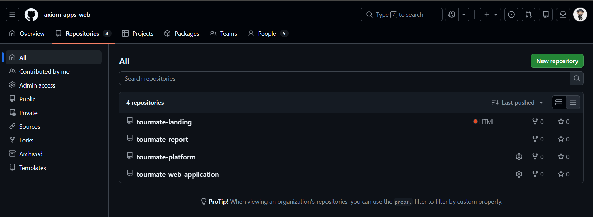

2. **Subida del código**
    - Se realizó el `push` del proyecto a la rama principal (`main`) del repositorio.
    - Se verificó que todos los recursos estén correctamente enlazados (rutas relativas).

   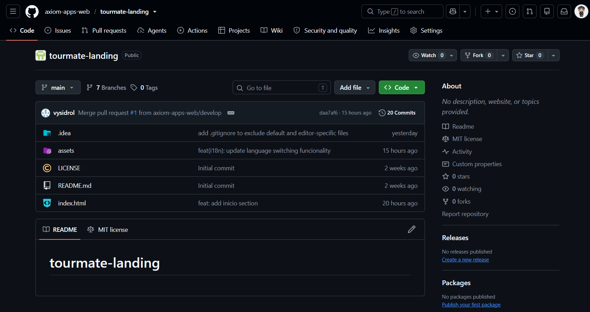

3. **Configuración de GitHub Pages**
    - En la sección *Settings* del repositorio, se habilitó **GitHub Pages**.
    - Se seleccionó la rama `main` como fuente de despliegue.
    - Se definió la carpeta raíz (`/root`) como directorio de publicación.

   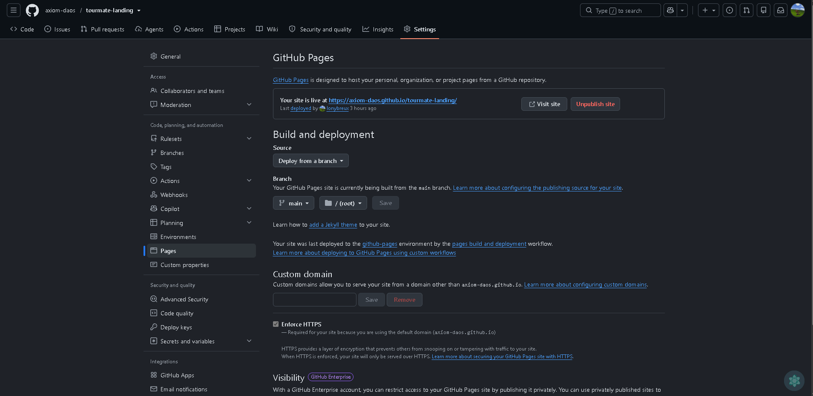

4. **Publicación automática**
    - GitHub Pages procesó automáticamente el contenido del repositorio.
    - En pocos minutos, generó una URL pública donde la Landing Page quedó disponible.

   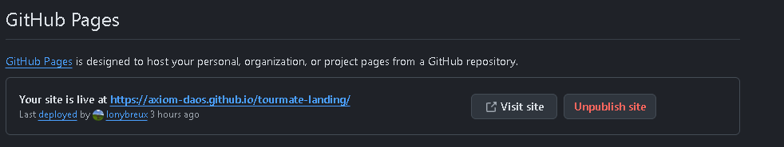

5. **Actualizaciones**
    - Cada vez que se realiza un nuevo `push` a la rama `main`, GitHub Pages actualiza automáticamente la página.
    - Esto permite mantener la Landing Page sincronizada con los cambios del repositorio sin intervención manual adicional.

#### Resultado
La Landing Page de TourMate fue desplegada exitosamente mediante GitHub Pages, permitiendo su acceso público a través de una URL estable. Esto facilita la presentación del producto a usuarios potenciales y valida la propuesta de valor del sistema de manera rápida y efectiva.

URL: [https://axiom-apps-web.github.io/tourmate-landing/](https://axiom-apps-web.github.io/tourmate-landing/)

#### *5.2.1.8. Team Collaboration Insights during Sprint*

Todos los miembros del equipo han participado activamente en la implementación de los productos del Sprint 1, lo cual se evidencia mediante los reportes de actividad y contribución del repositorio de GitHub de la organización Axiom.

**Insights**
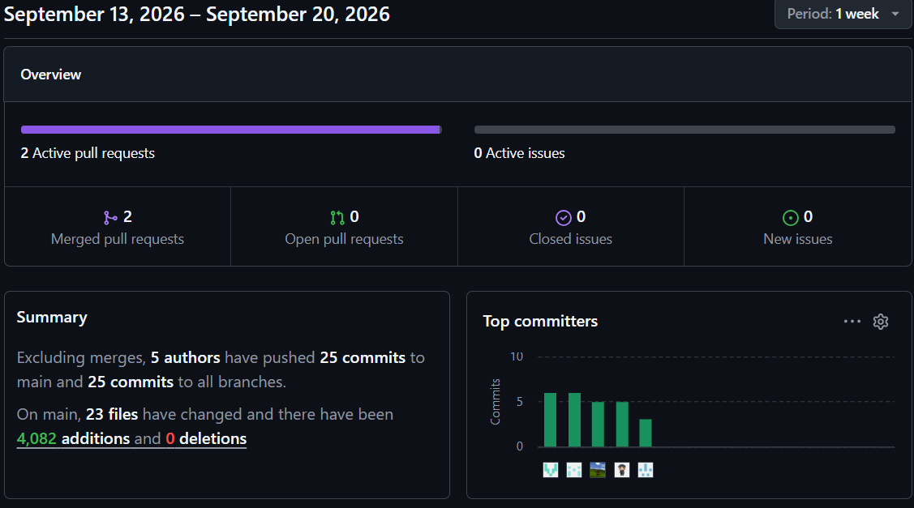

**Contributors**
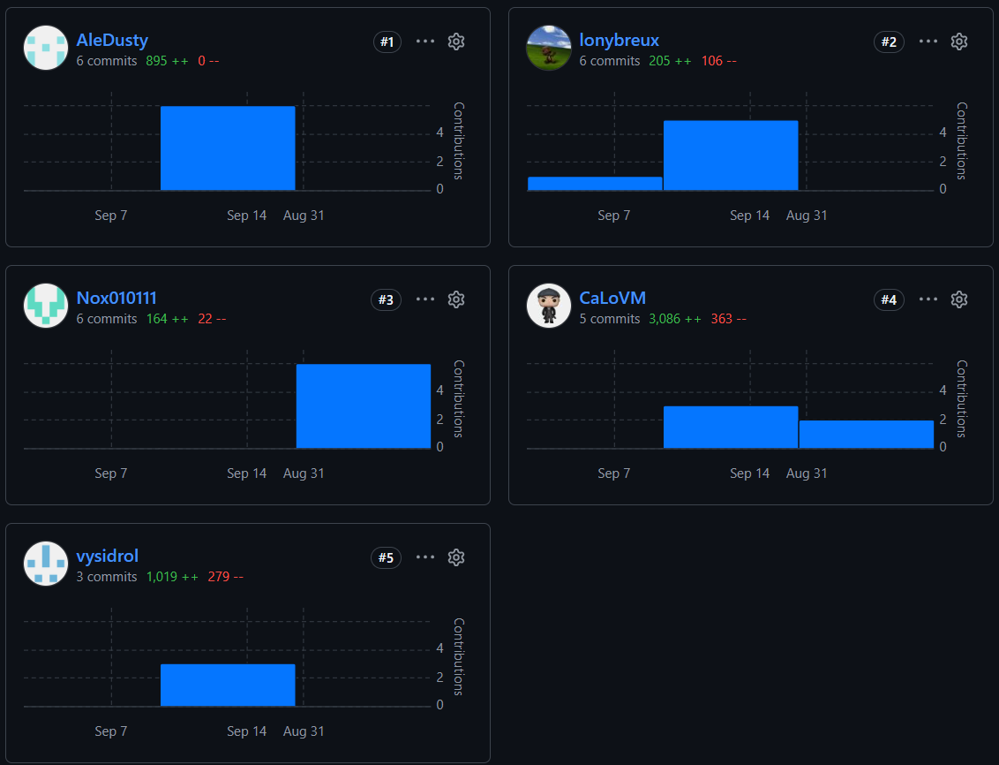

**Network graph**
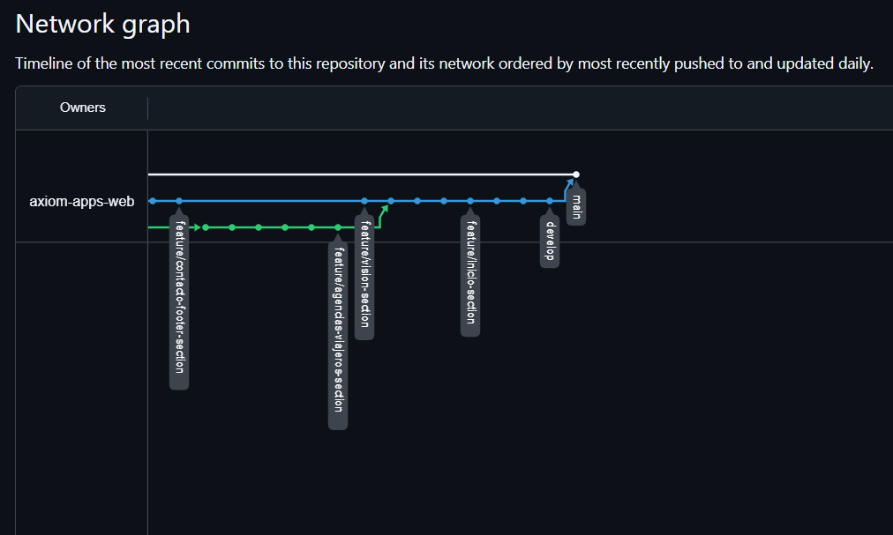

### 5.2.3. Sprint 3

#### *5.2.3.1. Sprint Planning 3*

Para el desarrollo del tercer sprint, nuestro esfuerzo se dividirá y centrará en dos aspectos fundamentales para la plataforma. Por el lado del frontend (Web Application), terminaremos de implementar la lógica de negocio pendiente, asegurando que la interactividad y los flujos de datos en las vistas sean precisos. Por el lado del backend (Web Services), nos enfocaremos en la construcción de nuestra API RESTful, implementando los endpoints CRUD reales y los controladores necesarios. Esta evolución nos permitirá migrar de los servicios simulados (MockAPI) a nuestra propia infraestructura backend, integrando ambas capas para consolidar el funcionamiento real de TourMate.

| **Sprint #** | 3 |
| --- |------------------------------------------------------------------------------------------------------------------------------------------------------------------------------------------------------------------------------------------|
| **Sprint Planning Background** | |
| **Date** | 2026-10-30 |
| **Time** | 4:00 PM |
| **Location** | Reunión virtual |
| **Prepared By** | Giancarlo Verastigue Martinez |
| **Attendees** | Giancarlo Verastigue Martinez, Matias Carrillo Acho, Valeria Milagros Ysidro Llashag, Manuel Alejandro Molina Vasquez, Alison Ariana Segura Guerra |
| **Sprint n – 1 Review Summary** | El Frontend de la aplicación web fue estructurado exitosamente y conectado a servicios simulados (MockAPI). Se lograron los objetivos visuales, de navegación y de diseño responsivo para los módulos de gestión de tours, monitoreo en vivo y perfiles. |
| **Sprint n – 1 Retrospective Summary** | El equipo mantuvo un excelente ritmo de trabajo gracias a la división detallada de tareas. Se acordó que para este nuevo ciclo es crítico priorizar la construcción del backend real para reemplazar los mocks y evitar cuellos de botella en la integración final de la lógica de negocio. |
| **Sprint Goal & User Stories** | |
| **Sprint 3 Goal** | Our focus is on finalizing the frontend business logic and developing the backend RESTful API with core CRUD operations for TourMate. This will be confirmed when frontend components successfully consume the real backend endpoints and business rules are fully functional. |
| **Sprint 3 Velocity** | 120 Story Points (Velocidad estimada sumando la carga de finalización de lógica Frontend y la construcción completa de los controladores y servicios Backend proyectados para este ciclo). |
| **Sum of Story Points** | 120 |

#### *5.2.3.2. Aspect Leaders and Collaborators*

A continuación se detalla la matriz de liderazgo y colaboración (LACX) para brindar claridad en la comunicación del equipo durante el desarrollo de las tareas de este Sprint.

Para este tercer sprint, los aspectos se han redefinido para alinearse con los objetivos duales del ciclo: finalizar el lado cliente y construir el backend real. Por ello, las áreas clave son: Lógica de Negocio Frontend (Frontend Business Logic), Servicios de Tours y Monitoreo (Tours & Tracking API), Servicios de Seguridad e Incidentes (Safety & Incidents API), y Arquitectura Core y Perfiles (Core API & Profiles).

| Team Member (Last Name, First Name) | GitHub Username | Frontend Business Logic | Tours & Tracking API | Safety & Incidents API | Core API & Profiles |
|-------------------------------------|-----------------| --- | --- | --- | --- |
| Verastigue Martinez, Giancarlo      | @CaLoVM         | C | L | C | C |
| Carrillo Acho, Matias               | @lonybreux      | C | C | L | C |
| Ysidro Llashag, Valeria Milagros         | @vysidrol      | L | C | C | C |
| Molina Vasquez, Manuel Alejandro    | @AleDusty       | L | C | C | C |
| Segura Guerra, Alison Ariana       | @Nox010111  | C | C | C | L |

#### *5.2.3.3. Sprint Backlog 3*

El objetivo principal de este tercer Sprint se dividió en dos frentes complementarios: por un lado, la evolución de la *Landing Page* institucional mediante la incorporación de secciones multimedia interactivas (*About-the-Team* y *About-the-Product*) para consolidar la propuesta de valor; y por otro lado, la construcción, integración y despliegue de los servicios backend RESTful (*Server-Side Software*) de la plataforma TourMate, estableciendo una arquitectura robusta basada en *Domain-Driven Design* (DDD) y el patrón CQRS (*Command Query Responsibility Segregation*) desarrollada con .Net, C# y persistencia relacional en MySQL. Durante este ciclo se implementa la lógica de negocio y persistencia transversal dividida en cuatro *Bounded Contexts* clave: la asignación, confirmación y consulta paramétrica de tours (*BC: Tour Management*), el seguimiento en tiempo real y transiciones de estado de expediciones activas (*BC: Tour Monitoring*), la gestión de alertas, persistencia de incidentes y umbrales biométricos (*BC: Safety & Incidents*), y el control de perfiles, bitácoras de experiencia y servicios de geolocalización (*BC: IAM & Profiles*). Las User Stories y Technical Stories planificadas han sido rigurosamente descompuestas en tareas de ingeniería (*Engineering Tasks* bajo las nomenclaturas `TS-LPxx.x` para Landing Page y `TS-Bxx.x` para Backend), cubriendo la creación de controladores REST, casos de uso/servicios de aplicación, modelos y agregados del dominio, validación de reglas de negocio, componentes de interfaz interactivos y documentación viva bajo OpenAPI/Swagger.

**Trello link:** [https://trello.com/b/GFgdnufq/tourmate-sprint-3](https://trello.com/b/GFgdnufq/tourmate-sprint-3)

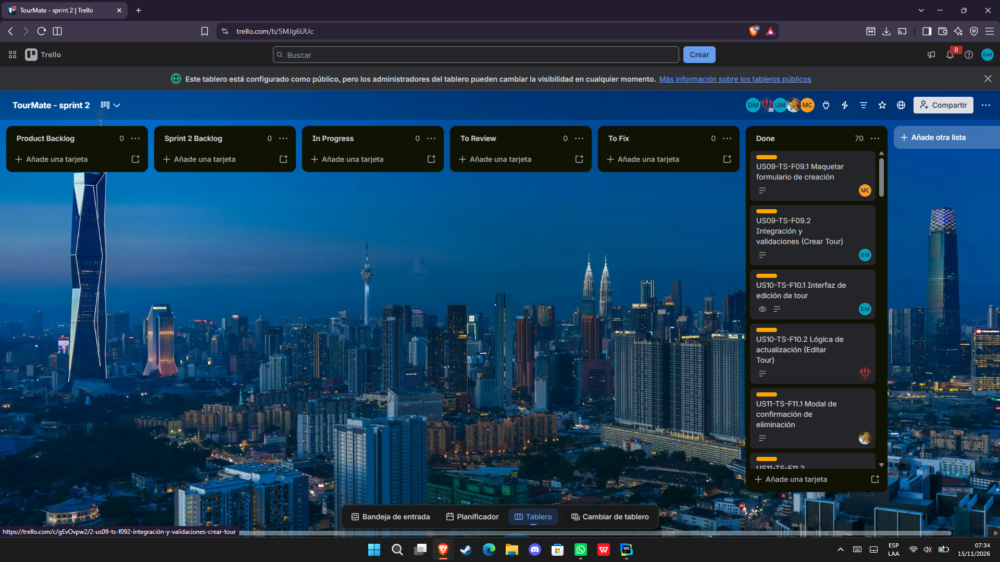
*Figura 5.7. Vista panorámica del Sprint Backlog 3 en Trello reflejando las tareas de desarrollo y flujo Scrum.*

| User Story Id | User Story Title | Work-Item / Task Id | Work-Item / Task Title | Description | Estimation (Hours) | Assigned To | Status |
| --- | --- | --- | --- | --- | --- | --- | --- |
| US-LP11 | Visualizar video institucional 'About-the-Team' | TS-LP11.1 | Integración multimedia de video About-the-Team | Desarrollar el contenedor multimedia e insertar el video institucional en la sección del equipo. | 3 | @vysidrol | Done |
| US-LP11 | Visualizar video institucional 'About-the-Team' | TS-LP11.2 | Optimización y adaptabilidad móvil de video | Ajustar relación de aspecto responsiva (16:9) y controles de reproducción para dispositivos móviles. | 2 | @vysidrol | Done |
| US-LP12 | Visualizar video demostrativo 'About-the-Product' | TS-LP12.1 | Integración de modal interactivo About-the-Product | Implementar el componente modal interactivo con overlay para reproducir el video demostrativo del producto. | 3 | @CaLoVM | Done |
| US-LP12 | Visualizar video demostrativo 'About-the-Product' | TS-LP12.2 | Vinculación con Call-to-Action y registro | Conectar los botones de acción del modal para redirigir fluidamente al flujo de planes y registro. | 2 | @CaLoVM | Done |
| US13 | Asignar turistas a un tour | TS-B13.1 | Implementar servicio de asignación | Desarrollar la lógica de negocio en el backend para vincular turistas a un tour específico. | 3 | @lonybreux | Done |
| US13 | Asignar turistas a un tour | TS-B13.2 | Validaciones de capacidad y estado | Implementar reglas de negocio para evitar sobrecupo o asignación a tours ya cerrados/cancelados. | 2 | @CaLoVM | To Do |
| US14 | Desasignar turista de un tour | TS-B14.1 | Implementar servicio de remoción | Crear el método en el backend para eliminar de forma segura la relación entre turista y tour. | 2 | @AleDusty | To Do |
| US14 | Desasignar turista de un tour | TS-B14.2 | Validación de expedición en curso | Agregar lógica para denegar o requerir confirmación extra si se intenta desasignar con la expedición iniciada. | 2 | @vysidrol | To Do |
| US15 | Confirmar asistencia | TS-B15.1 | Lógica de confirmación de estado | Desarrollar el servicio para actualizar y persistir el estado de confirmación de asistencia del participante. | 2 | @Nox010111 | To Do |
| US15 | Confirmar asistencia | TS-B15.2 | Manejo de cancelaciones | Implementar regla de negocio que permita cancelar asistencia notificando al administrador correspondiente. | 3 | @lonybreux | To Do |
| US16 | Buscar y filtrar tours | TS-B16.1 | Implementar consultas JPQL/SQL dinámicas | Crear repositorios con soporte de filtros paramétricos para búsquedas complejas de tours. | 4 | @CaLoVM | To Do |
| US16 | Buscar y filtrar tours | TS-B16.2 | Optimización y paginación de resultados | Aplicar soporte de paginación (ej. Pageable) a los resultados devueltos por la base de datos. | 3 | @AleDusty | To Do |
| US19 | Iniciar expedición | TS-B19.1 | Transición de estado a 'IN_PROGRESS' | Implementar servicio para actualizar el estado del schedule y generar el registro histórico de la expedición. | 3 | @vysidrol | To Do |
| US19 | Iniciar expedición | TS-B19.2 | Validación de permisos de guía | Verificar mediante control de roles que únicamente el guía asignado pueda disparar el evento de inicio. | 2 | @Nox010111 | To Do |
| US20 | Visualizar ruta del tour | TS-B20.1 | Modelo de datos de ruta y waypoints | Configurar entidades espaciales y mapeos de JPA para almacenar secuencias de coordenadas ordenadas. | 4 | @lonybreux | To Do |
| US20 | Visualizar ruta del tour | TS-B20.2 | Servicio de serialización geográfica | Preparar los datos y construir respuestas en formato JSON eficiente para el motor de mapas del cliente. | 3 | @CaLoVM | To Do |
| US23 | Visualizar progreso del recorrido | TS-B23.1 | Motor de cálculo de avance | Crear un servicio interno que evalúe y calcule el porcentaje de avance en base a checkpoints validados. | 3 | @AleDusty | To Do |
| US23 | Visualizar progreso del recorrido | TS-B23.2 | Eventos de finalización automática | Implementar triggers para marcar hitos de avance o detectar el 100% para notificar el cierre. | 2 | @vysidrol | To Do |
| US25 | Registrar experiencia del recorrido | TS-B25.1 | Repositorio de notas y experiencias | Configurar la entidad, relaciones y el acceso a datos para las anotaciones textuales de cada turista. | 2 | @Nox010111 | To Do |
| US25 | Registrar experiencia del recorrido | TS-B25.2 | Validaciones de contexto activo | Restringir y validar que el registro de experiencias se asocie obligatoriamente a una expedición en curso. | 2 | @lonybreux | To Do |
| US28 | Finalizar expedición | TS-B28.1 | Transición de estado a 'FINISHED' | Desarrollar servicio para cerrar formalmente el tour, detener rastreos y asentar el evento. | 3 | @CaLoVM | To Do |
| US28 | Finalizar expedición | TS-B28.2 | Consolidación de reporte final | Implementar lógica para consolidar métricas de la expedición (avance logrado, horas, incidencias). | 3 | @AleDusty | To Do |
| US29 | Monitorear ubicación de turistas | TS-B29.1 | Servicio de ingesta de coordenadas | Desarrollar la lógica optimizada para persistir en lote (batch) o streaming las coordenadas recibidas. | 5 | @vysidrol | To Do |
| US29 | Monitorear ubicación de turistas | TS-B29.2 | Agrupación de ubicaciones por tour | Construir consultas de alta velocidad que retornen únicamente la última coordenada conocida por turista. | 4 | @Nox010111 | To Do |
| US30 | Consultar estado general del grupo | TS-B30.1 | Agregación de métricas de grupo | Crear un Data Transfer Object (DTO) y servicio para resumir el estado de salud y posición de todo el grupo. | 4 | @lonybreux | To Do |
| US30 | Consultar estado general del grupo | TS-B30.2 | Cacheo de estado en tiempo real | Configurar un mecanismo de caché en memoria (ej. Redis) para soportar accesos concurrentes de monitoreo. | 4 | @CaLoVM | To Do |
| US32 | Consultar estado de salud básico | TS-B32.1 | Motor de umbrales biométricos | Desarrollar algoritmos base para clasificar los signos vitales obtenidos como valores normales o de riesgo. | 3 | @AleDusty | To Do |
| US32 | Consultar estado de salud básico | TS-B32.2 | Servicio de consulta de salud | Mapear la última lectura biométrica registrada para ser expuesta rápidamente al rol del guía. | 2 | @vysidrol | To Do |
| US33 | Reportar incidente | TS-B33.1 | Persistencia de incidentes de seguridad | Modelar la entidad, el repositorio y el servicio de creación para guardar los reportes de anomalías (SOS). | 3 | @Nox010111 | To Do |
| US33 | Reportar incidente | TS-B33.2 | Despacho de notificaciones a agencia | Configurar eventos de dominio para alertar internamente a la agencia inmediatamente al crearse un reporte. | 3 | @lonybreux | To Do |
| TS02 | Endpoint de gestión de tours | TS-B02.1 | API REST Controllers de Tours | Construir y exponer formalmente los endpoints GET, POST, PUT, DELETE asociándolos a los servicios creados. | 4 | @CaLoVM | To Do |
| TS02 | Endpoint de gestión de tours | TS-B02.2 | Documentación OpenAPI de Tours | Anotar los controladores con definiciones Swagger para tipar respuestas y requerimientos JSON. | 2 | @AleDusty | To Do |
| TS03 | Endpoint de gestión de expediciones | TS-B03.1 | API REST Controllers de Expediciones | Exponer las rutas HTTP correspondientes para el control del ciclo de vida (iniciar, finalizar) de expediciones. | 4 | @vysidrol | To Do |
| TS03 | Endpoint de gestión de expediciones | TS-B03.2 | Manejo global de excepciones | Configurar controladores de consejo (Advices) para devolver códigos HTTP correctos (400, 401, 404, 409). | 3 | @Nox010111 | To Do |
| TS04 | Endpoint de monitoreo de ubicación | TS-B04.1 | API REST Controllers de Localización | Implementar el endpoint POST preparado para alta concurrencia desde los dispositivos de campo. | 4 | @lonybreux | To Do |
| TS04 | Endpoint de monitoreo de ubicación | TS-B04.2 | Endpoint GET de estado geoespacial | Construir la interfaz de salida HTTP para que la UI de monitoreo consuma posiciones en vivo (polling). | 3 | @CaLoVM | To Do |
| TS07 | Endpoint de gestión de alertas | TS-B07.1 | API REST Controllers de Alertas | Configurar y exponer las rutas REST encargadas de servir el registro activo de alertas generadas. | 3 | @AleDusty | To Do |
| TS07 | Endpoint de gestión de alertas | TS-B07.2 | Validación de payloads (DTOs) | Aplicar decoradores de validación estricta a las cargas útiles de entrada para garantizar la integridad. | 2 | @vysidrol | To Do |
| TS09 | Endpoint de perfil y notificaciones | TS-B09.1 | API REST Controllers de Perfiles | Implementar los endpoints seguros que permitan exponer y actualizar la información de cuenta del usuario logueado. | 3 | @Nox010111 | To Do |
| TS09 | Endpoint de perfil y notificaciones | TS-B09.2 | Endpoints de historial de notificaciones | Exponer el listado de eventos de sistema ordenados para alimentar el panel de notificaciones frontend. | 3 | @lonybreux | To Do |

#### *5.2.3.4. Development Evidence for Sprint Review*

Durante el Sprint 3, el equipo de desarrollo aplicó la metodología GitFlow y el estándar de Conventional Commits (`feat`, `fix`, `docs`, `chore`, `test`) para asegurar la trazabilidad, atomicidad y consistencia del código fuente a través de los tres repositorios que conforman la plataforma TourMate: la página de aterrizaje institucional (`tourmate-landing`), la aplicación web de cara al usuario (`tourmate-web-application`) y los servicios backend RESTful (`tourmate-platform`).

A continuación, se presentan las secciones correspondientes a la evidencia de desarrollo y commits organizados por repositorio:

##### 1. Repositorio Landing Page: `tourmate-landing`

*Trazabilidad de modificaciones y despliegue continuo en la Landing Page orientados a la incorporación de recursos multimedia (videos About-the-Team y About-the-Product) y ajustes de diseño responsivo.*

| Hash | Tipo | Módulo / Componente | Descripción del Commit | Autor |
| :--- | :---: | :--- | :--- | :---: |
| `8351e9c` | Merge | Multimedia / Landing Videos | Merge pull request #2 from axiom-daos/feature/landing-video-sections | @Nox010111 |
| `d865891` | Feat | Multimedia / About-the-Team | feat(landing): update news section and integrate team video | @Nox010111 |
| `73850a1` | Fix | Layout & Conflicts | fix: resolve merge conflict in index.html | @CarrilloMatias |
| `8c37b66` | Merge | Multimedia / Landing Videos | Merge pull request #1 from axiom-daos/feature/landing-video-sections | @Nox010111 |
| `25dcc2f` | Feat | Multimedia / About-the-Product | feat(landing): add product presentation video | @Nox010111 |
| `b94eec2` | Feat | Multimedia / About-the-Team & Sections | feat(landing): update landing page with video sections | @Nox010111 |
| `641f9f3` | Feat | Navigation & Call to Action | feat: update join button link to external home page with target and rel attributes | @CaLoVM |

##### 2. Repositorio Frontend: `tourmate-web-application`

*Trazabilidad de desarrollo en la aplicación Single Page Application construida en Vue, cubriendo la lógica de negocio, integración con servicios REST y componentes de presentación.*

| Hash | Tipo | Módulo / Bounded Context | Descripción del Commit | Autor |
| :--- | :---: | :--- | :--- | :---: |
| `71c65bb` | Merge | Infrastructure / Fix | Merge branch 'feature/fix' into develop | @CaLoVM |
| `2272a67` | Fix | Environment / API Config | fix(environment): update tourmate provider API base URL for development and production environments | @CaLoVM |
| `8f57e28` | Fix | Endpoints & Gateway | fix(api-endpoints): update API base URL to use tourmate provider endpoint for comments, incidents, payments, plans, reviews, and subscriptions | @CaLoVM |
| `50f8878` | Fix | Profiles & IAM | fix(profiles): update profile role constants and API base URL for consistency | @CaLoVM |
| `21eacb0` | Fix | Safety Monitoring | fix(safety-monitoring): update API base URL to use tourmate provider endpoint | @CaLoVM |
| `106e1c5` | Fix | Tour Management | fix(tours-api): update API base URL for tourmate provider endpoint | @CaLoVM |
| `38281aa` | Fix | IAM / Assemblers | fix(assemblers): normalize user and tour guide IDs and roles for consistency | @CaLoVM |
| `0ce0bc7` | Fix | Localization / i18n | fix(localization): update role keys in English and Spanish translation files | @CaLoVM |
| `2e705bb` | Fix | Active Tours | fix(active-tours): update finishedAt to allow null and adjust guideId handling | @CaLoVM |
| `f69fd8e` | Merge | Subscriptions & Payment Management | Merge branch 'feature/subscriptions-and-payment-management-business-logic' into develop | @vysidrol |
| `bcb2323` | Feat | Subscriptions & Payment Management | feat(subscription): enhance API endpoints and assemblers for resilient backend and query integration | @vysidrol |
| `4581dc2` | Merge | Feedback and Tour Reviews | Merge branch 'feedback-and-tour-reviews2-business-logic' into develop | @Nox010111 |
| `0bdf0b6` | Fix | Feedback and Tour Reviews | fix(feedback-and-tour-reviews): sanitize review creation payload and optimize comment queries by review id | @Nox010111 |
| `b25aac9` | Fix | Profiles & IAM | fix(profiles): update difficulty translation key to difficulty_label in localization files | @CaLoVM |
| `0bc589e` | Feat | Profiles & IAM | feat(profiles): add routing and localization for My Profile section | @CaLoVM |
| `2464e2c` | Feat | Profiles & IAM | feat(profiles): add ProfileTours component with HTML, CSS, and TypeScript logic for managing assigned tours | @CaLoVM |
| `c995159` | Feat | Profiles & IAM | feat(profiles): add ProfileToursStore and assigned tour management logic | @CaLoVM |
| `8398c25` | Feat | Profiles & IAM | feat(profiles): implement ProfileAssembler and related API endpoint for profile management | @CaLoVM |
| `2c507a3` | Feat | Profiles & IAM | feat(profiles): add Profile entity and ProfileRole enum for user profiles | @CaLoVM |
| `090df13` | Feat | Subscriptions & Payment Management | feat(subscription): add digital payment receipt modal with fiscal details and print action | @vysidrol |
| `ec273bc` | Feat | Subscriptions & Payment Management | feat(subscription): introduce financial KPI summary cards and cancellation dialog in subscription dashboard | @vysidrol |
| `0837984` | Feat | Subscriptions & Payment Management | feat(subscription): add interactive checkout confirmation modal and localized plan features in plan selection view | @vysidrol |
| `a047d3f` | Feat | Subscriptions & Payment Management | feat(subscription): implement expenditure computation, renewal date estimation, and cancellation reason logging in store | @vysidrol |
| `cd814c8` | Feat | Subscriptions & Payment Management | feat(subscription): add comprehensive i18n keys for subscription metrics, receipts, and checkout dialogs | @vysidrol |
| `8089825` | Feat | Safety Monitoring | feat(safety-monitoring): enhance Spanish localization for safety monitoring features | @AleDusty |
| `033cc7f` | Feat | Safety Dashboard | feat(safety-dashboard): add SafetyDashboard component for managing incidents and safety data | @AleDusty |
| `f80b3d3` | Feat | Safety Monitoring | feat(safety-monitoring): implement safety monitoring store with location and telemetry management | @AleDusty |
| `58c6272` | Feat | Safety & Incidents | feat(incident-list): enhance incident resolution with user prompt for notes | @AleDusty |
| `def8543` | Feat | Safety & Incidents | feat(incident-store): enhance offline incident synchronization with duplicate checks and automatic retries | @AleDusty |
| `b1d6f79` | Feat | Safety & Incidents | feat(incident-list): enhance UI with sync button, offline banner, and status badges | @AleDusty |
| `1501fcb` | Feat | Tour Monitoring | feat(active-tour-form): add loading state and enhance form handling for active tours | @CaLoVM |
| `5cf550b` | Feat | Feedback and Tour Reviews | feat(feedback-and-tour-reviews): enhance UI and visual design of the dashboard | @Nox010111 |

##### 3. Repositorio Backend: `tourmate-platform`

*Trazabilidad de desarrollo en la API RESTful construida con Spring Boot 3 y arquitectura Domain-Driven Design (DDD), cubriendo controladores, casos de uso, agregados del dominio y persistencia JPA.*

| Hash | Tipo | Módulo / Bounded Context | Descripción del Commit | Autor |
| :--- | :---: | :--- | :--- | :---: |
| `693b63a` | Merge | Tour Management | Merge branch 'feature/tour-management' into develop | @CarrilloMatias |
| `a7e602c` | Feat | Tour Management | feat: add addCheckpoint function in tour controller | @CarrilloMatias |
| `441f794` | Feat | Tour Management | feat: add add checkpoint command from resource assembler | @CarrilloMatias |
| `66a6d19` | Feat | Tour Management | feat: add addCheckpointResource | @CarrilloMatias |
| `6a47617` | Feat | Tour Management | feat: add handle function with add checkpoint command implementation | @CarrilloMatias |
| `e7812d9` | Feat | Tour Management | feat: add handle function to add a checkpoint command in tour command service interface | @CarrilloMatias |
| `f7546bf` | Refactor | Tour Management | refactor: map checkpoint persistence entities with tour persistence entity | @CarrilloMatias |
| `67d0b74` | Feat | Tour Management | feat: add command to add a checkpoint | @CarrilloMatias |
| `6640ea0` | Merge | Core / Fix | Merge branch 'feature/fix' into develop | @CaLoVM |
| `82d9671` | Feat | DevOps / Infrastructure | feat: add Dockerfile for building and running the application, update ActiveToursController and Roles | @CaLoVM |
| `a01a307` | Merge | Subscriptions & Payment Management | Merge branch 'feature/subscriptions-and-payment-management' into develop | @vysidrol |
| `c15d41d` | Fix | Subscriptions & Payment Management | fix(subscription): configure resilient deserialization and ignore unknown payload properties | @vysidrol |
| `df57ebd` | Merge | Feedback and Tour Reviews | Merge branch 'feature/feedback-and-tour-reviews' into develop | @Nox010111 |
| `1bc5d06` | Fix | Feedback and Tour Reviews | fix(feedback-and-tour-reviews): make review and comment request resources ignore unknown properties | @Nox010111 |
| `868aaaa` | Chore | Infrastructure / DevOps | chore: add compose.yaml for MySQL runtime containerization | @CarrilloMatias |
| `279ea83` | Chore | Configuration | chore: remove docker compose from tracking | @CarrilloMatias |
| `b42bfcc` | Feat | Tour Management | feat: add tour controller with full CRUD endpoints | @CarrilloMatias |
| `4d37d6a` | Feat | Tour Management | feat: add tour transforms and resource assemblers | @CarrilloMatias |
| `b0c70e9` | Feat | Tour Management | feat: add tour resources and OpenAPI schema definitions | @CarrilloMatias |
| `cf184ac` | Feat | Tour Management | feat: add tour services implementations and application layer | @CarrilloMatias |
| `69565db` | Feat | Tour Management | feat: add tour query service interface | @CarrilloMatias |
| `8d2931b` | Feat | Tour Management | feat: add tour command service interface | @CarrilloMatias |
| `9313dc5` | Feat | Subscriptions & Payment Management | feat(subscription): add subscription plans database seeder for runtime bootstrap | @vysidrol |
| `a3a473e` | Feat | Subscriptions & Payment Management | feat(subscription): implement rest controllers and resource assemblers for plans, subscriptions, and payments | @vysidrol |
| `de9f352` | Feat | Subscriptions & Payment Management | feat(subscription): declare rest request and response resources with openapi schema documentation | @vysidrol |
| `55faaba` | Feat | Subscriptions & Payment Management | feat(subscription): implement command and query application services with result handling | @vysidrol |
| `708e7b5` | Feat | Subscriptions & Payment Management | feat(subscription): implement repository adapters connecting domain contracts with jpa persistence | @vysidrol |
| `81492c0` | Refactor | Tour Monitoring | Refactor ActiveToursController and resources to standardize terminology and improve documentation clarity | @CaLoVM |
| `3a44f6b` | Merge | Tour Monitoring | Merge branch 'feature/tour-monitoring' into develop | @CaLoVM |
| `d04a1fb` | Feat | Tour Monitoring | Add ActiveToursController with CRUD operations for ActiveTour resources | @CaLoVM |
| `9d95082` | Feat | Tour Monitoring | Add ActiveTour command and query services for create, update, and delete operations | @CaLoVM |
| `2c33f15` | Feat | Safety and Incident Management | feat: add detailed documentation for UpdateIncidentResource parameters | @AleDusty |
| `af157bc` | Feat | Safety and Incident Management | feat: add detailed documentation for SafetyMonitoringController endpoints | @AleDusty |
| `c059112` | Feat | Safety and Incident Management | feat: enhance IncidentsController with detailed documentation for incident management endpoints | @AleDusty |
| `71bbce3` | Feat | Safety and Incident Management | feat: add SafetyMonitoringController for managing safety monitoring and locations CRUD operations | @AleDusty |
| `d97ca14` | Feat | Safety and Incident Management | feat: add IncidentsController for managing incident CRUD operations | @AleDusty |
| `22665d6` | Feat | Safety and Incident Management | feat: add IncidentRepositoryAdapter for incident data access | @AleDusty |

---

#### *5.2.3.5. Execution Evidence for Sprint Review*

Durante el tercer Sprint, la validación de la solución se estructuró a través de la ejecución integrada de los tres productos de software que componen la plataforma TourMate: la Landing Page institucional, la Web Application (Frontend Vue) y los Web Services RESTful con persistencia relacional en MySQL. A continuación, se detallan los resultados y evidencias de ejecución en cada frente tecnológico:

##### 1. Evidencia de Ejecución de la Landing Page
La Landing Page institucional (`tourmate-landing`) fue validada en producción, verificando la carga asíncrona de los reproductores multimedia embebidos para las secciones *About-the-Team* y *About-the-Product*, la correcta navegación entre anclas y la adaptabilidad responsiva en pantallas de escritorio y dispositivos móviles:

*   **Sección About-the-Team:** Reproducción fluida del video institucional y renderizado dinámico de tarjetas de desarrolladores.
*   **Sección About-the-Product:** Despliegue interactivo del modal de video demostrativo y enlaces directos hacia el catálogo comercial de planes.
*   **Internacionalización (i18n):** Conmutación instantánea de textos entre español e inglés sin recarga de página.

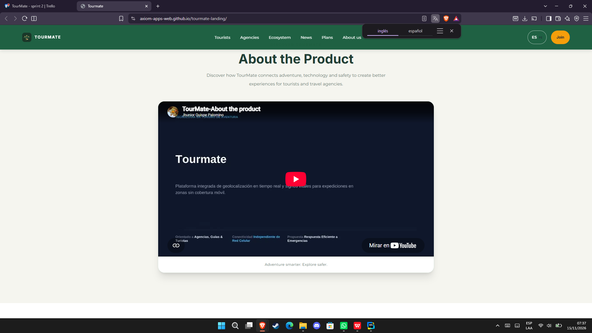

##### 2. Evidencia de Ejecución de la Web Application (Frontend)
La aplicación web interactiva desarrollada en Vue (`tourmate-web-application`) fue ejecutada en el entorno de pruebas y producción (Firebase Hosting), interactuando con los contratos de datos de la API:

*   **Módulo de Gestión de Tours y Checkpoints:** Creación de tours con itinerarios, waypoints geográficos y asignación de guías líderes.
*   **Módulo de Monitoreo de Expediciones e Incidentes:** Visualización en vivo del estado de expediciones activas y registro de reportes de anomalías en campo.
*   **Módulo de Suscripciones y Pagos:** Selección interactiva de planes de agencia, simulación de pasarela de pago y generación de recibo digital.
*   **Módulo de Reseñas y Perfiles:** Registro de calificaciones por estrellas, comentarios colaborativos y panel de administración de perfil.

A continuación, se presentan las capturas de pantalla de los módulos funcionales ejecutándose en tiempo real sobre la aplicación web desarrollada en Vue:

*Figura 5.14. Pantalla principal y panel de control de la Web Application TourMate en producción.*

*Figura 5.15. Módulo de Gestión de Tours: creación de itinerarios, waypoints geográficos y asignación operativa.*

*Figura 5.16. Módulo de Monitoreo: telemetría en vivo, seguimiento de expediciones activas y geolocalización.*

*Figura 5.17. Módulo de Seguridad: registro de incidentes, niveles de severidad y protocolos de contingencia.*

*Figura 5.18. Módulo de Suscripciones: selección de planes de agencia, simulación de facturación y estados transaccionales.*

*Figura 5.19. Módulo de Feedback: valoraciones por estrellas y testimonios de usuarios en la plataforma.*

##### 3. Evidencia de Ejecución de Web Services y Base de Datos (Backend Spring Boot & MySQL)
Para certificar el correcto funcionamiento de la arquitectura backend bajo DDD y CQRS, se ejecutó un protocolo de pruebas sobre los controladores REST y el motor de persistencia relacional:

*   **Persistencia Relacional (MySQL):** Verificación de la inicialización de esquemas, creación de llaves foráneas y ejecución de seeders de catálogo (`plans`, `roles`, `users`).
*   **Peticiones REST POST (Creación de Recursos):** Verificación de respuestas con código de estado HTTP `201 Created` y payload serializado en JSON.
*   **Peticiones REST GET (Consulta y Listado):** Verificación de respuestas con código de estado HTTP `200 OK` retornando colecciones de entidades y Value Objects.

**Persistencia en Base de Datos MySQL:**

*A continuación, se documenta la estructura de tablas relacionales generadas y pobladas automáticamente durante la inicialización de la plataforma:*

*Figura 5.14. Esquema de tablas generadas en la base de datos MySQL `tour_mate`.*

**Ejecución de Petición HTTP POST (Creación Exitosa):**

*A continuación, se presentan las capturas de peticiones REST ejecutadas de forma satisfactoria sobre los controladores de la plataforma:*

*Figura 5.15. Ejecución de petición HTTP POST devolviendo código de estado 201 Created con el DTO serializado en JSON.*

**Ejecución de Petición HTTP GET (Consulta de Recursos):**

*Figura 5.16. Ejecución de petición HTTP GET devolviendo código de estado 200 OK con el listado de recursos persistidos.*

##### 4. Video de Demostración y Ejecución del Sprint 3
Siguiendo los lineamientos de evaluación del Sprint Review, se estableció el registro audiovisual técnico demostrando la operatividad integrada de los tres productos (Landing Page, Web Application y Backend RESTful con MySQL):

**Sprint 3 Live Demonstration Video:** `[url]`  

---

#### *5.2.3.6. Services Documentation Evidence for Sprint Review*

El backend de TourMate cuenta con documentación interactiva estandarizada bajo la especificación **OpenAPI 3.1**, y desplegada públicamente en la nube en el entorno de producción de :  
**URL de Swagger UI en Producción:** [https://](https://)

##### Catálogo de Servicios RESTful y Endpoints Desplegados en Producción:

A continuación, se documenta la totalidad de los controladores y endpoints interactivos expuestos en Swagger UI en el servicio activo en la nube:

**1. Vista Panorámica General de la Plataforma y Autenticación:**  
Muestra la cabecera del servicio, especificación OpenAPI 3.1, configuración del servidor en la nube y los endpoints iniciales de gestión de usuarios (`Users`) y generación de tokens de autenticación (`Tokens`).

*Figura 5.17. Vista general de la especificación OpenAPI TourMate Platform.*

**2. Endpoints de Usuarios, Tokens e Incidentes:**  
Endpoints para registro y consulta de usuarios (`Users`), autenticación de credenciales (`Tokens`) y gestión completa de incidentes de seguridad en campo (`Incidents`).

*Figura 5.18. Endpoints interactivos documentados para Users, Tokens e Incident Management.*

**3. Endpoints de Planes Comerciales y Monitoreo de Expediciones:**  
Endpoints CRUD para el catálogo de planes de suscripción de agencias (`Plans`) y administración del ciclo de vida de expediciones activas (`ActiveTours`).

*Figura 5.19. Endpoints interactivos documentados para Plans y Active Tours.*

**4. Endpoints de Transacciones de Pago, Reseñas y Comentarios:**  
Endpoints para el libro mayor de pagos de agencias (`Payments`), calificación de experiencias turísticas (`Reviews`) y comentarios colaborativos (`Comments`).

*Figura 5.20. Endpoints interactivos documentados para Payments, Reviews y Comments.*

**5. Endpoints de Telemetría de Seguridad, Roles, Suscripciones y Tours:**  
Endpoints para ingesta de coordenadas y telemetría (`Safety Monitoring`), asignación de roles IAM (`Roles`), ciclo de vida y cancelación de suscripciones (`Subscriptions`) y catálogo principal de tours (`Tours`).

*Figura 5.21. Endpoints interactivos documentados para Safety Monitoring, Roles, Subscriptions y Tour Management.*

---

#### *5.2.3.7. Software Deployment Evidence for Sprint Review*

Durante este tercer Sprint, el proceso de despliegue (Deployment) marcó un hito fundamental para el proyecto con la puesta en producción de nuestra primera versión real del Web Service y su respectiva base de datos relacional. Además, se dio continuidad a los despliegues de la Landing Page y la Web Application, aplicando un enfoque de entrega continua e iterativa para integrar las correcciones solicitadas por el docente y la nueva lógica de negocio. A continuación, se detallan las actividades, configuraciones en los proveedores de nube y los procesos realizados para cada uno de los productos de software.

##### Tabla Resumen de Despliegue de la Plataforma TourMate

A fin de facilitar la evaluación de los entregables y garantizar el acceso directo a los servicios en producción, se consolida la siguiente matriz con las URLs públicas de despliegue y repositorios asociados:

| Componente | Entorno / Plataforma | URL de Producción | Repositorio GitHub | Estado |
| :--- | :--- | :--- | :--- | :---: |
| **Landing Page** | GitHub Pages / Hosting | https://axiom-daos.github.io/tourmate-landing/ | [https://github.com/axiom-apps-web/tourmate-landing](https://github.com/axiom-apps-web/tourmate-landing) | *Desplegado* |
| **Frontend Web Application** | Firebase Hosting / Cloud | https://tourmate-axiom.web.app/home | [https://github.com/axiom-apps-web/tourmate-web-application](https://github.com/axiom-apps-web/tourmate-web-application) | *Desplegado* |
| **Backend RESTful API & Swagger UI** | Render Cloud Services | https://tourmate-platform | [https://github.com/axiom-apps-web/tourmate-platform](https://github.com/axiom-apps-web/tourmate-platform) | *Desplegado* |

##### Credenciales de Acceso para Evaluación (Cuentas Demo)

A continuación, se proporcionan las cuentas de demostración configuradas para la evaluación de los diferentes roles del sistema, tanto en el consumo directo de la API RESTful (a través de Swagger UI) como en la interacción de las interfaces de usuario:

| Rol de Usuario | Entorno de Aplicación | Usuario / Correo Electrónico | Contraseña de Prueba | Alcance y Flujo de Evaluación |
| :--- | :--- | :--- | :--- | :--- |
| **Administrador del Sistema (`ROLE_ADMIN`)** | Frontend Web & Backend API | `demo.admin@tourmate.pe` | `SecurePass123!` | Acceso a métricas globales, catálogos y auditoría transversal del sistema. |
| **Dueño de Agencia (`ROLE_AGENCY_OWNER`)** | Frontend Web & Backend API | `demo.agency@tourmate.pe` | `SecurePass123!` | Gestión completa de suscripciones, planes comerciales y catálogo de tours. |
| **Guía de Expedición (`ROLE_TOUR_GUIDE`)** | Frontend Web & Backend API | `demo.guide@tourmate.pe` | `SecurePass123!` | Monitoreo en tiempo real de expediciones, telemetría y alertas de incidentes. |
| **Turista / Cliente (`ROLE_USER`)** | Frontend Web & Backend API | `demo.tourist@tourmate.pe` | `SecurePass123!` | Exploración paramétrica de tours, checkout simulado y registro de reseñas. |

##### Detalle de Despliegue por Componente:

#### 1. Landing Page (GitHub Pages)
Nuestra Landing Page ya se encontraba configurada y desplegada en GitHub Pages desde el primer sprint. Para esta tercera iteración, los trabajos se centraron en aplicar las mejoras recomendadas por el docente y en la integración de los videos promocionales y explicativos: *"About the Product"* y *"About the Team"*.

**Proceso de Despliegue:**
Dado que la integración continua (CI/CD) ya estaba configurada nativamente con el repositorio, no fue necesario realizar configuraciones adicionales en la nube. El despliegue de esta nueva versión fue completamente automático:
1.  Se integraron los cambios y nuevos recursos multimedia en la rama de desarrollo.
2.  Se realizó el *Merge* hacia la rama `main`.
3.  GitHub Actions detectó los cambios y disparó automáticamente el *build* y despliegue del sitio estático.

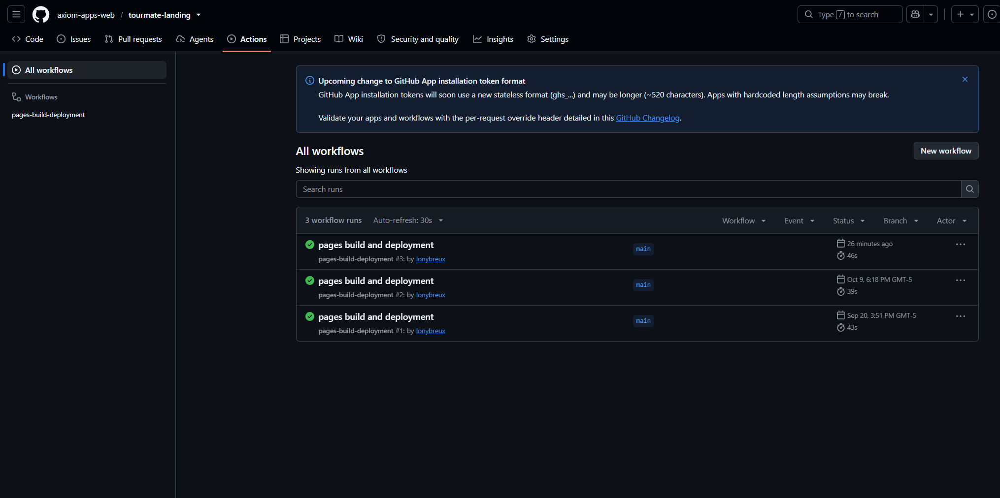
*Figura 5.22. Flujo de despliegue automatizado de la Landing Page mediante GitHub Actions.*

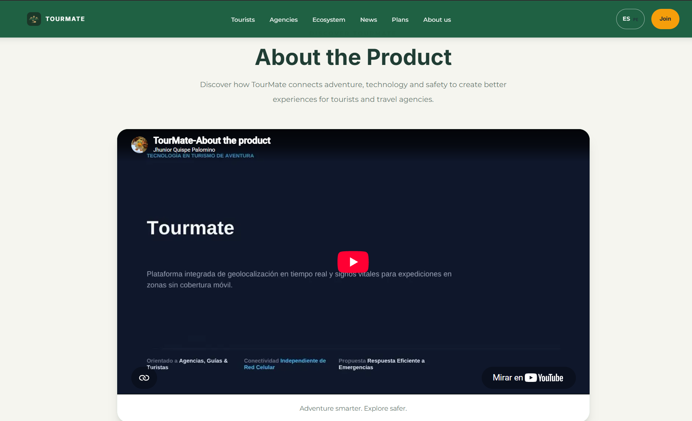
*Figura 5.23. Sección integrada About the Product en la Landing Page con reproductor de video.*

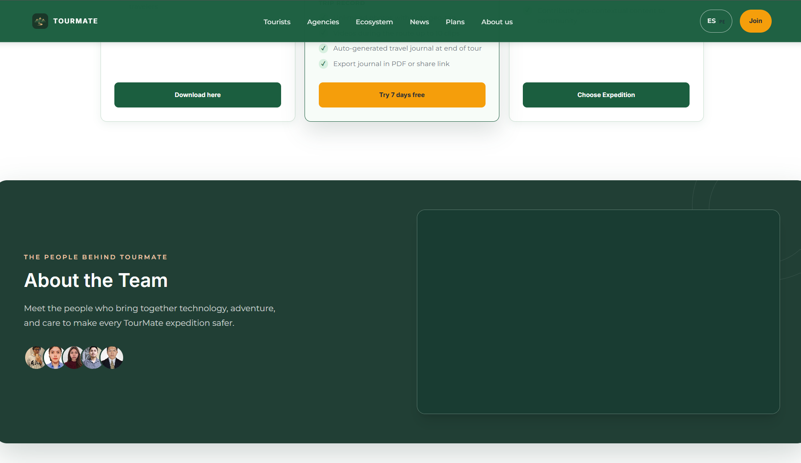
*Figura 5.24. Sección integrada About the Team en la Landing Page con perfil del equipo.*

URL: [https://axiom-daos.github.io/tourmate-landing/](https://axiom-daos.github.io/tourmate-landing/)

#### 2. Web Application - Frontend (Firebase Hosting)
La aplicación web interactiva (Frontend desarrollado en Vue) ya contaba con su infraestructura configurada en Firebase Hosting desde el Sprint 2. En este ciclo, se implementó la lógica de negocio restante y se aplicaron mejoras de usabilidad (UI/UX) basadas en el feedback del docente.

**Proceso de Despliegue:**
Al tratarse de una actualización sobre un servicio ya aprovisionado, el despliegue consistió en la compilación local optimizada y la subida de los nuevos artefactos mediante la interfaz de línea de comandos (CLI) de Firebase:
1.  **Build:** Se compiló el proyecto para producción ejecutando `ng build`, generando los archivos estáticos optimizados en la carpeta `dist`.
2.  **Deploy:** Se ejecutó el comando `firebase deploy --only hosting` para subir la nueva versión a los servidores de Google.

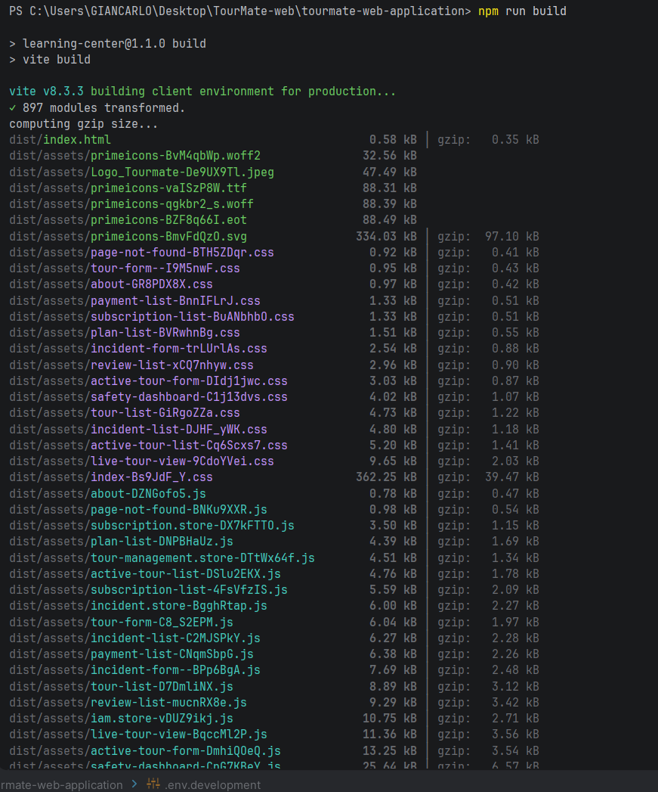
*Figura 5.25. Compilación y optimización de producción de la Web Application mediante Vue.*

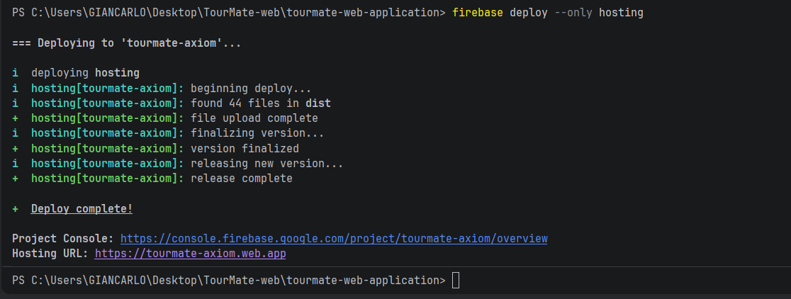
*Figura 5.26. Despliegue exitoso del frontend distribuido en los servidores de Firebase Hosting.*

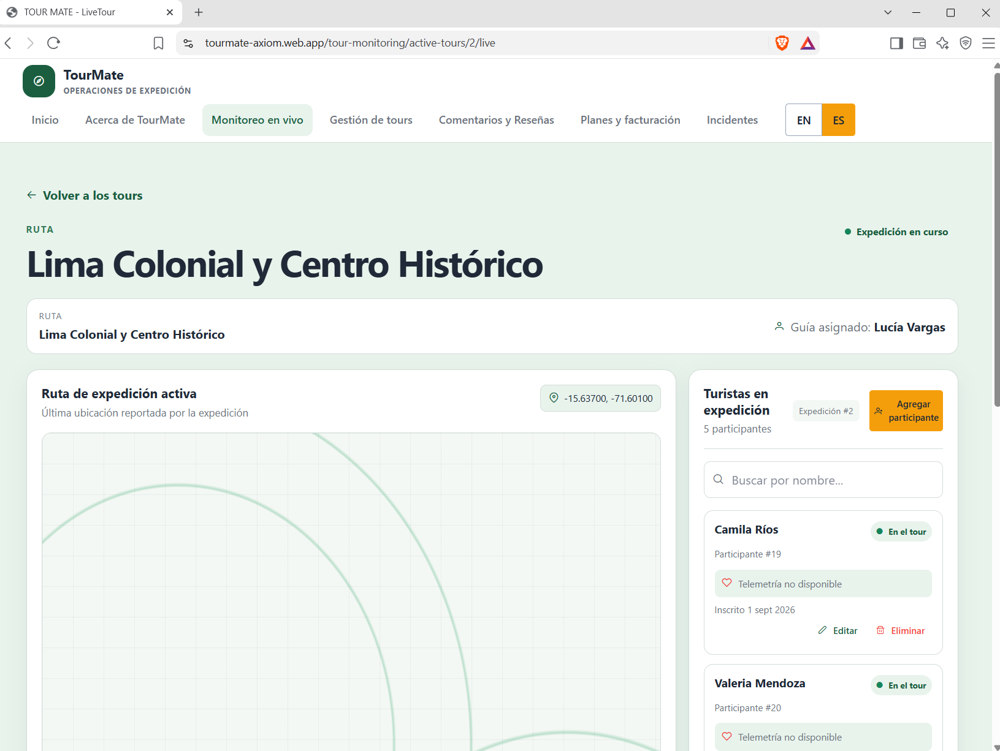
*Figura 5.27. Interfaz funcional de la Web Application desplegada en producción sobre Firebase Hosting.*

URL: [https://tourmate-axiom.web.app/home](https://thttps://tourmate-axiom.web.app/home)

#### 3. Web Services y Base de Datos (Render)
Para el despliegue del backend real y la base de datos relacional de TourMate se utilizó la plataforma en la nube **Render**, aprovisionando tanto la instancia de MySQL como el servicio web RESTful desarrollado en Spring Boot 3 con Java 21.

**Paso 1: Despliegue de la Base de Datos (MySQL)**
1. En el dashboard de Render se creó un nuevo servicio seleccionando **New > MySQL** dentro del proyecto TourMate.
2. Se asignó como nombre de base de datos `tour_mate` y un usuario administrador, seleccionando la región de Oregon con MySQL versión 16.
3. Una vez aprovisionada la instancia, Render generó la cadena de conexión interna (`Internal Database URL`) con soporte SSL activo (`sslmode=require`), utilizada para enlazar el backend de forma segura y sin exponer credenciales en la red pública.

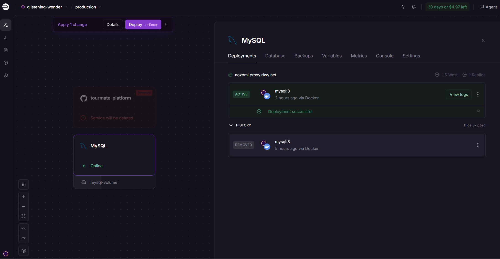
*Figura 5.28. Aprovisionamiento e instancia de base de datos MySQL `tour_mate` en Render.*

**Paso 2: Despliegue del Web Service (Backend Spring Boot)**
1. Se seleccionó **New > Web Service** y se vinculó directamente el repositorio de GitHub `axiom-daos/tourmate-platform`.
2. Se configuraron los comandos de construcción y arranque de la aplicación:
   * **Build Command:** `mvn clean package -DskipTests` (compila el proyecto y empaqueta el artefacto `.jar`).
   * **Start Command:** `java -jar target/tourmate-platform-0.0.1-SNAPSHOT.jar` (inicia el servicio web en el puerto configurado).
3. **Variables de Entorno (Environment Variables):** Se inyectaron en el panel de Render las variables necesarias para la conexión y seguridad:
   * `DATABASE_URL`: Cadena de conexión JDBC hacia la instancia MySQL aprovisionada en el Paso 1.
   * `DATABASE_USER` y `DATABASE_PASSWORD`: Credenciales de acceso a la base de datos.
   * `PORT`: Puerto de escucha del servicio (`8092`), mapeado automáticamente al dominio HTTPS de Render.
   * `JWT_SECRET`: Clave secreta para la firma y validación de tokens de autenticación.
4. Render ejecutó el despliegue continuo mediante build automático, asignando el dominio seguro con certificado SSL: `https://tourmate-platform.onrender.com`.

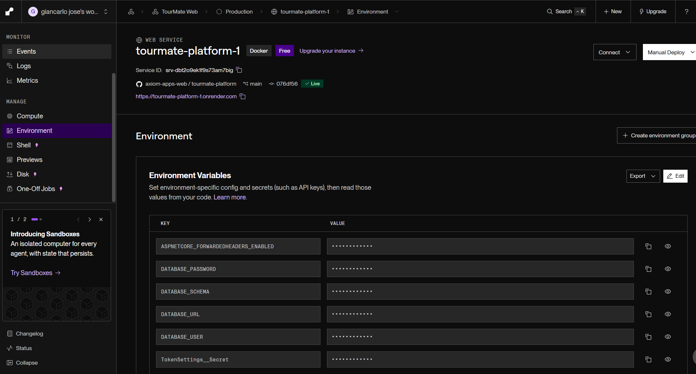
*Figura 5.29. Variables de entorno configuradas para la conexión a base de datos y puertos en Render.*

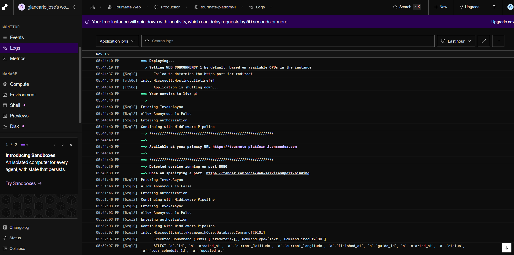
*Figura 5.30. Log de construcción y despliegue exitoso del servicio backend en Render.*

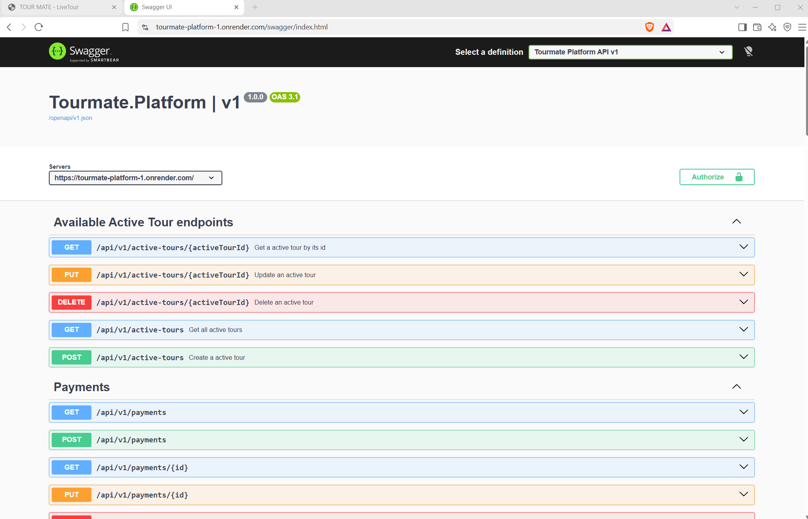
*Figura 5.31. Verificación de la disponibilidad de la API y Swagger UI en el dominio de producción.*

URL: [https://tourmate-platform.onrender.com/swagger-ui/index.html#](https://tourmate-platform.onrender.com/swagger-ui/index.html#)

---

#### *5.2.3.8. Team Collaboration Insights during Sprint*

Durante el Sprint 3, el equipo mantuvo una participación activa y coordinada a través de la organización de GitHub `axiom-daos`. A continuación, se presenta el análisis de las métricas de colaboración y contribución por cada repositorio del proyecto:

##### 1. Repositorio Landing Page (`tourmate-landing`)
La actividad en la página de aterrizaje se concentró en la integración de los videos institucionales (*About-the-Team* y *About-the-Product*), la adaptación responsiva para dispositivos móviles y la actualización de los textos de la propuesta de valor. La gráfica refleja commits organizados y revisiones puntuales que permitieron desplegar las mejoras de forma continua vía GitHub Pages.

*Figura 5.32. Registro de actividad y frecuencia de commits en el repositorio de la Landing Page.*

##### 2. Repositorio Frontend (`tourmate-web-application`)
El desarrollo de la aplicación web en Vue reflejó un ritmo constante de trabajo para culminar la lógica de negocio pendiente. Las gráficas de *Pulse* y *Contributors* evidencian una distribución equilibrada de tareas entre los desarrolladores para los módulos de suscripciones, monitoreo de expediciones, reporte de incidentes y reseñas, integrando las ramas de características mediante Pull Requests hacia la rama `develop`.

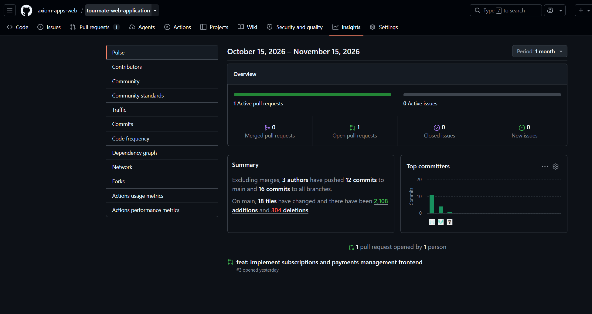
*Figura 5.33. Frecuencia y ritmo de contribuciones en la aplicación web durante el Sprint 3.*

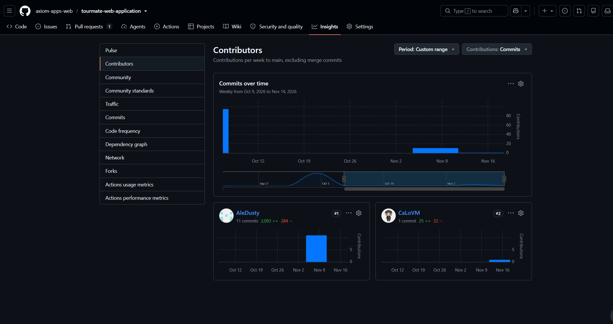
*Figura 5.34. Distribución de commits y aportes de código por integrante en el frontend.*

##### 3. Repositorio Backend (`tourmate-platform`)
El repositorio del Web Service en Spring Boot registró la mayor densidad de actividad técnica del sprint. Los picos de contribución corresponden a la estructuración de la arquitectura DDD por capas (controladores REST, servicios de aplicación, agregados del dominio y adaptadores de persistencia JPA). Las métricas confirman la participación colaborativa de los integrantes en la implementación de sus respectivos Bounded Contexts y la preparación del despliegue en Render.

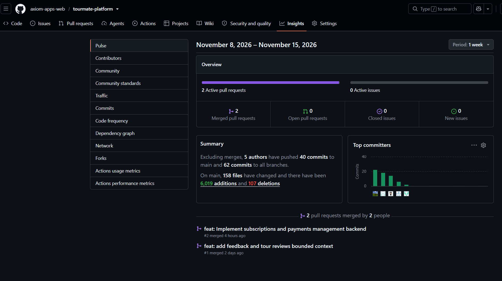
*Figura 5.35. Frecuencia de commits y picos de desarrollo en la API RESTful durante el Sprint 3.*

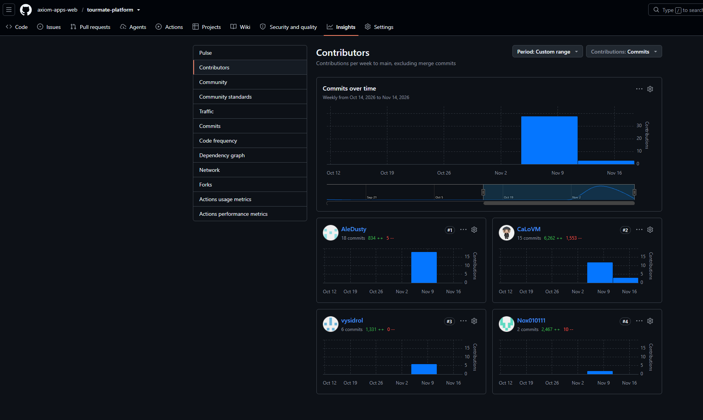
*Figura 5.36. Registro de aportes y líneas de código por desarrollador en el backend.*

## Conclusiones

### Sprint 1 – Landing Page y documentación del proyecto

- **Sobre el análisis del problema y la investigación del usuario:** Se concluye que las entrevistas realizadas a dueños de agencias de tours y turistas de aventura permitieron identificar necesidades, expectativas y puntos de dolor relevantes para el desarrollo de TourMate. La información recopilada fue fundamental para la definición de *User Personas*, *Empathy Maps* y *Journey Maps*, los cuales sirvieron como base para la priorización de funcionalidades y la elaboración del *Problem Statement*.

- **Sobre la propuesta de valor y validación inicial:** La elaboración de la *Landing Page* permitió comunicar de forma clara los objetivos, beneficios y funcionalidades principales de TourMate, funcionando como un medio de validación temprana de la idea de negocio. Se evidenció que presentar una interfaz informativa y accesible favorece la comprensión del problema y fortalece el interés de potenciales usuarios y clientes B2B.

- **Sobre la documentación y modelado del proyecto:** La construcción del reporte técnico permitió consolidar los hallazgos del *Problem Statement*, *Needfinding*, *User Personas*, *Empathy Maps*, *Journey Maps*, *Event Storming* y *Ubiquitous Language*, generando una visión integral del dominio del negocio. Asimismo, el uso de metodologías como *Domain-Driven Design (DDD)* facilitó la identificación de *Bounded Contexts* y responsabilidades del sistema desde etapas tempranas.

- **Sobre la definición de requerimientos:** La especificación inicial de *User Stories* y criterios de aceptación permitió transformar necesidades de usuarios en funcionalidades concretas, proporcionando una guía estructurada para el desarrollo de los siguientes sprints y reduciendo ambigüedades en la planificación técnica.

### Bibliografía

- Brown, S. (2020). *The C4 model for visualising software architecture*. C4Model.com. Recuperado de [https://c4model.com](https://c4model.com)
- Driessen, V. (2010). *A successful Git branching model*. Nvie. Recuperado de [https://nvie.com/posts/a-successful-git-branching-model](https://nvie.com/posts/a-successful-git-branching-model)
- Evans, E. (2003). *Domain-Driven Design: Tackling Complexity in the Heart of Software*. Addison-Wesley Professional. Recuperado de [https://www.domainlanguage.com/ddd](https://www.domainlanguage.com/ddd)
- Newman, S. (2021). *Building Microservices: Designing Fine-Grained Systems* (2nd ed.). O'Reilly Media. Recuperado de [https://samnewman.io/books/building_microservices_2nd_edition](https://samnewman.io/books/building_microservices_2nd_edition)
- Walls, C. (2022). *Spring in Action* (6th ed.). Manning Publications. Recuperado de [https://www.manning.com/books/spring-in-action-sixth-edition](https://www.manning.com/books/spring-in-action-sixth-edition)

## Anexos

### Anexo A. Videos de exposiciones

- Exposición AV1: [https://upcedupe-my.sharepoint.com/:v:/g/personal/u202419483_upc_edu_pe/IQAxE4dWMH1_TrOpYjIh0i_tATv3SJgLVSN9_JqQWd0TLNE?nav=eyJyZWZlcnJhbEluZm8iOnsicmVmZXJyYWxBcHAiOiJPbmVEcml2ZUZvckJ1c2luZXNzIiwicmVmZXJyYWxBcHBQbGF0Zm9ybSI6IldlYiIsInJlZmVycmFsTW9kZSI6InZpZXciLCJyZWZlcnJhbFZpZXciOiJNeUZpbGVzTGlua0NvcHkifX0&e=XklIVq](https://upcedupe-my.sharepoint.com/:v:/g/personal/u202419483_upc_edu_pe/IQAxE4dWMH1_TrOpYjIh0i_tATv3SJgLVSN9_JqQWd0TLNE?nav=eyJyZWZlcnJhbEluZm8iOnsicmVmZXJyYWxBcHAiOiJPbmVEcml2ZUZvckJ1c2luZXNzIiwicmVmZXJyYWxBcHBQbGF0Zm9ybSI6IldlYiIsInJlZmVycmFsTW9kZSI6InZpZXciLCJyZWZlcnJhbFZpZXciOiJNeUZpbGVzTGlua0NvcHkifX0&e=XklIVq)

### Anexo B. Videos de entrevistas

- Entrevista 1 - Mateo Escudero, Agencia de Tour: https://upcedupe-my.sharepoint.com/:v:/g/personal/u20241f714_upc_edu_pe/IQCf3pj989dtRqsxlQP-cphyAdmHJbpSw14HLGTRks5qOyM?e=L98d2n&nav=eyJyZWZlcnJhbEluZm8iOnsicmVmZXJyYWxBcHAiOiJTdHJlYW1XZWJBcHAiLCJyZWZlcnJhbFZpZXciOiJTaGFyZURpYWxvZy1MaW5rIiwicmVmZXJyYWxBcHBQbGF0Zm9ybSI6IldlYiIsInJlZmVycmFsTW9kZSI6IldpZXcifX0%3D
- Entrevista 2 - Aarón Espinosa, Agencia de Tour: https://upcedupe-my.sharepoint.com/:v:/g/personal/u20221g231_upc_edu_pe/IQAofZYR8ATPSbWHvKq3vOSvAZ1mk5uCZxK_sr8rN9qoqI4?nav=eyJyZWZlcnJhbEluZm8iOnsicmVmZXJyYWxBcHAiOiJPbmVEcml2ZUZvckJ1c2luZXNzIiwicmVmZXJyYWxBcHBQbGF0Zm9ybSI6IldlYiIsInJlZmVycmFsTW9kZSI6IldpZXciLCJyZWZlcnJhbFZpZXciOiJNeUZpbGVzTGlua0NvcHkifX0&e=CzroE4
- Entrevista 3 - Carlos Gutierrez, Agencia de Tour: https://upcedupe-my.sharepoint.com/personal/u202319057_upc_edu_pe/_layouts/15/stream.aspx?id=/personal/u202319057_upc_edu_pe/Documents/Entrevista+DAOP.mp4&nav=eyJyZWZlcnJhbEluZm8iOnsicmVmZXJyYWxBcHAiOiJPbmVEcml2ZUZvckJ1c2luZXNzIiwicmVmZXJyYWxBcHBQbGF0Zm9ybSI6IldlYiIsInJlZmVycmFsTW9kZSI6InZpZXciLCJyZWZlcnJhbFZpZXciOiJNeUZpbGVzTGlua0NvcHkifX0&ga=1&referrer=StreamWebApp.Web&referrerScenario=AddressBarCopied.view.2461ff76-283b-41f2-bb72-df3bc61e4215&ClientRender=1
- Entrevista 4 - Sofia Mendoza, Turista de aventura: https://upcedupe-my.sharepoint.com/:v:/g/personal/u20241f714_upc_edu_pe/IQBPxk5ihQP7Qpk1EiObhUKMAcqE0PkmidpljYmgsKZhw60?e=y94DfE&nav=eyJyZWZlcnJhbEluZm8iOnsicmVmZXJyYWxBcHAiOiJTdHJlYW1XZWJBcHAiLCJyZWZlcnJhbFZpZXciOiJTaGFyZURpYWxvZy1MaW5rIiwicmVmZXJyYWxBcHBQbGF0Zm9ybSI6IldlYiIsInJlZmVycmFsTW9kZSI6IldpZXcifX0%3D
- Entrevista 5 - Romina Antonella Molina Vásquez, Turista de aventura: https://upcedupe-my.sharepoint.com/:v:/g/personal/u20221g231_upc_edu_pe/IQAQPNKuz_cKS4krk8KnLmoKAaAOQuWIL6WmZXL4T30cJJQ?nav=eyJyZWZlcnJhbEluZm8iOnsicmVmZXJyYWxBcHAiOiJPbmVEcml2ZUZvckJ1c2luZXNzIiwicmVmZXJyYWxBcHBQbGF0Zm9ybSI6IldlYiIsInJlZmVycmFsTW9kZSI6IldpZXciLCJyZWZlcnJhbFZpZXciOiJNeUZpbGVzTGlua0NvcHkifX0&e=B3HGgd
- Entrevista 6 - Miler Rodriguez, Turista de aventura: https://upcedupe-my.sharepoint.com/:v:/g/personal/u202419483_upc_edu_pe/IQDe0UWGvKUwRojgbs_XPIuJAclsUfNSUJK04_8jjCFOE7A?nav=eyJyZWZlcnJhbEluZm8iOnsicmVmZXJyYWxBcHAiOiJPbmVEcml2ZUZvckJ1c2luZXNzIiwicmVmZXJyYWxBcHBQbGF0Zm9ybSI6IldlYiIsInJlZmVycmFsTW9kZSI6InZpZXciLCJyZWZlcnJhbFZpZXciOiJNeUZpbGVzTGlua0NvcHkifX0&e=Szx6cw

### Anexo D. Materiales de ideación y diseño

- Lean UX Canvas del proyecto TourMate: 
- Big Picture EventStorming y Design-Level EventStorming: https:
- Wireframe de la landing page: [https://www.figma.com/design/2tgN0Xgvcoyy2nlZKFWU1R/TourMate---Wireframe?node-id=1-649&t=1eosnKm0G5GXiVCR-1](https://www.figma.com/design/2tgN0Xgvcoyy2nlZKFWU1R/TourMate---Wireframe?node-id=1-649&t=1eosnKm0G5GXiVCR-1)
- Mock-up de la landing page: [https://www.figma.com/design/ugarmexs9RkezsXpIEhS8e/TourMate---Landing-Page-Mock-up?node-id=0-1&t=yxRaDMrgsaPLR6T8-1](https://www.figma.com/design/ugarmexs9RkezsXpIEhS8e/TourMate---Landing-Page-Mock-up?node-id=0-1&t=yxRaDMrgsaPLR6T8-1)
- Wireframes de la aplicación web: [https://www.figma.com/design/SKEFgPxKRE4cJmEnGjuAx3/DAOS_final?node-id=0-1&t=yXf7imx6mdAPUOiO-1](https://www.figma.com/design/SKEFgPxKRE4cJmEnGjuAx3/DAOS_final?node-id=0-1&t=yXf7imx6mdAPUOiO-1)
- Wireflows de la aplicación web:[https://www.figma.com/design/SKEFgPxKRE4cJmEnGjuAx3/DAOS_final?node-id=0-1&t=yXf7imx6mdAPUOiO-1](https://www.figma.com/design/SKEFgPxKRE4cJmEnGjuAx3/DAOS_final?node-id=0-1&t=yXf7imx6mdAPUOiO-1)
- Mock-ups de la aplicación web:[https://www.figma.com/design/SKEFgPxKRE4cJmEnGjuAx3/DAOS_final?node-id=0-1&t=yXf7imx6mdAPUOiO-1](https://www.figma.com/design/SKEFgPxKRE4cJmEnGjuAx3/DAOS_final?node-id=0-1&t=yXf7imx6mdAPUOiO-1)
- Prototipo de la aplicación web: [https://www.figma.com/design/SKEFgPxKRE4cJmEnGjuAx3/DAOS_final?node-id=0-1&t=yXf7imx6mdAPUOiO-1](https://www.figma.com/design/SKEFgPxKRE4cJmEnGjuAx3/DAOS_final?node-id=0-1&t=yXf7imx6mdAPUOiO-1)

### Anexo E. Repositorios y despliegues

- Repositorio del informe del proyecto: [https://github.com/axiom-apps-web/tourmate-report](https://github.com/axiom-apps-web/tourmate-report)
- Repositorio de la landing page: [https://github.com/axiom-apps-web/tourmate-landing](https://github.com/axiom-apps-web/tourmate-landing)
- Repositorio del Web Application: [https://github.com/axiom-apps-web/tourmate-web-application](https://github.com/axiom-apps-web/tourmate-web-application)
- Repositorio del Backend: [https://github.com/axiom-apps-web/tourmate-platform](https://github.com/axiom-apps-web/tourmate-platform)
- Despliegue de la landing page: [https://axiom-apps-web.github.io/tourmate-landing/](https://axiom-apps-web.github.io/tourmate-landing/)
- Tablero del Sprint Backlog 1: [https://trello.com/b/gCKcMjVR/tourmate-sprint-1](https://trello.com/b/gCKcMjVR/tourmate-sprint-1)

### Anexo F. Herramientas utilizadas

- Trello, para gestión del backlog y tareas del proyecto: https://trello.com
- Gherkin, para criterios de aceptación en formato Given-When-Then: https://cucumber.io/docs/gherkin/
- Miro, para dinámicas de EventStorming: https://miro.com/
- Figma, para wireframes, mock-ups y prototipos: https://www.figma.com
- Canva, para recursos visuales del producto: https://www.canva.com
- UXPressia, para User Personas y Customer Journey Maps: https://uxpressia.com
- Lucidchart, para diagramas del sistema: https://www.lucidchart.com/ / https://lucidchart.com
- GitHub, para control de versiones y colaboración: https://github.com
- Visual Studio Code, para edición de código y archivos Markdown: https://code.visualstudio.com/
- GitHub Pages, para despliegue de la landing page y frontend web: https://pages.github.com
- Structurizr, para diagramas C4: https://structurizr.com
- Vertabelo, para diagramas de base de datos: https://vertabelo.com

### Anexo G. Referencias bibliográficas con enlace

- Guía para ejecutar Big Picture Event Storming: https://bit.ly/bpes-guide
- Guía práctica de EventStorming remoto: https://ddd-practitioners.com/2023/03/20/remote-eventstorming-workshop/
- Material sobre historias de usuario: https://www.scrummanager.com/files/scrum_manager_historias_usuario.pdf
- Libro de ingeniería de software usado como referencia: https://www.javier8a.com/itc/bd1/ld-Ingenieria.de.software.enfoque.practico.7ed.Pressman.PDF