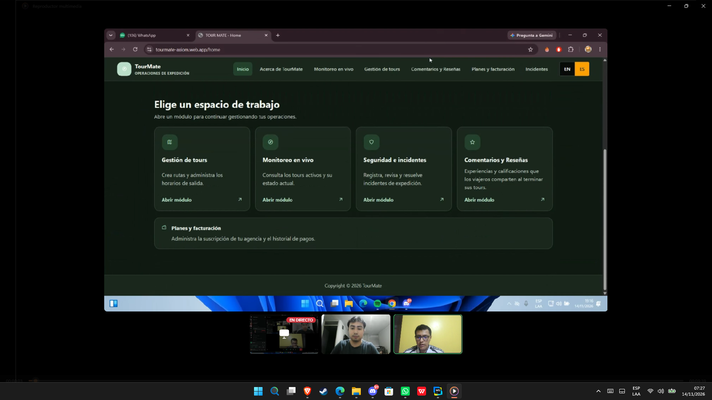
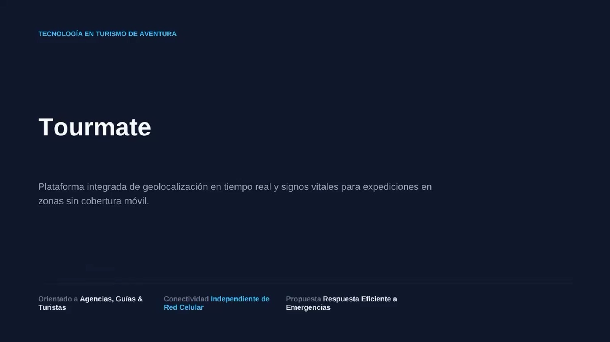

## 5.3. Validation Interviews

#### 5.3.1. Diseño de Entrevistas

Las entrevistas de validación constituyen la principal técnica de investigación cualitativa para evaluar la propuesta de valor, la utilidad práctica y la experiencia de uso de TourMate en un escenario real. A diferencia de la etapa de descubrimiento inicial, estas entrevistas se centran en interactuar con los usuarios finales tras su aproximación o uso simulado de la aplicación, obteniendo perspectivas críticas que alimentan el reporte técnico.

---

##### Objetivos Generales del Proceso de Entrevistas

1. Validar la efectividad del monitoreo y la respuesta a incidentes: Evaluar si el sistema de alertas tempranas, el seguimiento de ubicación y la telemetría IoT responden adecuadamente a las necesidades reales de seguridad en zonas de baja conectividad.
2. Medir la usabilidad y la experiencia offline: Comprobar la facilidad de uso de la aplicación móvil (para turistas y guías) y el panel web centralizado (para agencias) bajo condiciones de operación sin conexión continua.
3. Analizar la percepción de valor y disposición de adopción: Determinar el impacto del uso de dispositivos wearables y checkpoints Bluetooth (BLE) en la confianza del turista y en la eficiencia operativa de la agencia.
4. Identificar fricciones y oportunidades de mejora: Recoger feedback directo sobre flujos específicos (creación de tours, asignación de equipos, reporte de incidentes y sincronización asincrónica) para enriquecer las conclusiones del reporte final.

---

##### Segmento 1: Dueños o Responsables de Agencias de Turismo de Aventura

**Perfil del entrevistado:** Propietarios, gerentes de operaciones, administradores o guías principales de agencias que operan rutas de trekking, montañismo o turismo de aventura en zonas de baja conectividad del Perú.

---

**Apertura y Contexto Operativo**

1. ¿Cómo ha venido manejando la coordinación y supervisión de sus grupos en expediciones recientes en comparación con sus métodos tradicionales?
2. Tras conocer el funcionamiento del dashboard centralizado y los reportes de TourMate, ¿qué tan alineada se encuentra esta herramienta con la realidad operativa de su agencia?

**Validación del Monitoreo y Gestión de Incidentes**

3. Durante la simulación o uso del panel de control en vivo, ¿la visualización de la ubicación de los grupos y el estado de los checkpoints BLE le otorga la claridad necesaria para prevenir situaciones de riesgo?
4. ¿Cómo evalúa el sistema de alertas automáticas ante anomalías (desvíos de ruta o signos vitales fuera de rango)? ¿Considera que agiliza la toma de decisiones frente a los métodos convencionales?

**Funcionalidad Offline y Sincronización Asincrónica**

5. Teniendo en cuenta las zonas sin señal celular en las rutas peruanas, ¿qué tan útil le resulta el mecanismo de sincronización asincrónica para asegurar la trazabilidad de los datos al retornar la conectividad?
6. ¿Encontró alguna limitación o complejidad técnica al registrar o auditar el avance de las expediciones desde la plataforma?

**Adopción, Costos y Expectativas de Negocio**

7. ¿Considera que el modelo de suscripción SaaS combinado con la infraestructura de hardware se ajusta al presupuesto y capacidad de inversión de una Mypeta turística en el Perú?
8. ¿Qué funcionalidades considera que son absolutamente indispensables desde el primer día de implementación en campo y cuáles podrían incorporarse en fases posteriores?

**Gestión de Catálogo y Planificación de Tours**

9. Al momento de crear un nuevo tour y configurar sus checkpoints Bluetooth (BLE), ¿qué tan intuitivo le parece definir las rutas y asociar a los guías líderes?
10. ¿Qué dificultades encuentra actualmente al momento de realizar la asignación de pasajeros, gestionar la nómina oficial y entregar los equipos antes de que los grupos inicien el recorrido?
11. ¿Cómo le beneficia contar con un historial de rutas pasadas para estructurar nuevos itinerarios o planificar el mantenimiento preventivo de la logística?

---

##### Segmento 2: Turistas de Aventura

**Perfil del entrevistado:** Personas nacionales o extranjeras que hayan realizado o participado en actividades de turismo de aventura en zonas remotas de los Andes o la selva peruana en los últimos años.

---

**Apertura y Experiencia con la Aplicación**

1. ¿Con qué frecuencia realiza viajes de aventura o trekking y cuáles son los principales desafíos o temores a los que se enfrenta al recorrer zonas aisladas?
2. ¿Cómo calificaría su experiencia al utilizar la aplicación móvil de TourMate durante la navegación de la ruta y el registro de su recorrido?
3. En comparación con aplicaciones de mapas genéricas, ¿qué tan útil le pareció contar con mapas offline y la visualización de los checkpoints del tour?

**Seguridad, Privacidad y Uso de Dispositivos Wearables**

4. Si la agencia le proporciona un dispositivo wearable para el monitoreo pasivo de su ubicación y signos vitales durante el viaje, ¿generó esto mayor tranquilidad y confianza en su seguridad personal?
5. ¿Le causó alguna preocupación respecto a su privacidad el hecho de que sus datos de salud y ubicación fueran monitoreados temporalmente durante la expedición? ¿Qué condiciones le harían sentir más seguro al respecto?
6. ¿Qué dudas o reparos tendría antes de colocarse un dispositivo de monitoreo biométrico provisto por la agencia al iniciar una expedición exigente?
7. En caso de sufrir una emergencia o extraviarse, ¿qué tan cómodo se sentiría utilizando un botón de pánico físico o digital integrado en la aplicación móvil?

**Funcionalidades de Experiencia y Contexto**

8. ¿Qué tan valioso considera el acceso a información contextual (clima, datos históricos de la ruta, puntos de interés) y el resumen digital automático (diario de viaje con fotos y estadísticas) al finalizar el recorrido?
9. ¿Influyó positivamente el uso de esta tecnología en su decisión de elegir una agencia de turismo frente a otras alternativas tradicionales del mercado?
10. ¿Cómo califica la utilidad de recibir alertas tempranas o notificaciones sobre cambios climáticos repentinos o advertencias de terreno durante la caminata?
11. ¿Qué opina sobre la generación automática de un diario de viaje digital al finalizar la expedición para compartirlo con familiares o amigos?

---

##### Consideraciones Metodológicas

**Cantidad de entrevistas:** mínimo 3 y máximo 5 entrevistas por segmento (total: entre 6 y 10 entrevistas) para alcanzar saturación temática en una etapa de descubrimiento.

**Registro:** Las entrevistas deben ser grabadas con consentimiento del entrevistado para su posterior análisis. Se recomienda el uso de una guía de toma de notas que permita capturar citas textuales relevantes.

**Análisis:** Los resultados serán procesados mediante agrupamiento de respuestas por temática, identificando patrones comunes, necesidades no cubiertas y citas representativas para validar o refutar las hipótesis de problema y solución.

**Ética:** Antes de cada entrevista se informará al participante sobre el propósito de la investigación, la confidencialidad de sus respuestas y su derecho a retirarse en cualquier momento. No se recopilará información personal identificable más allá de la necesaria para el reclutamiento.

---

#### 5.3.2. Registro de Entrevistas

En esta sección se documentan las entrevistas de validación realizadas a los usuarios objetivo de ambos segmentos tras interactuar con la plataforma TourMate. Cada registro incluye los datos del participante, la evidencia audiovisual de la sesión y una síntesis estructurada del feedback cualitativo recibido sobre la funcionalidad, usabilidad y valor de la solución.

##### Segmento 1: Dueños o Responsables de Agencias de Turismo de Aventura

**Entrevista de Validación 1:**

| | |
| :--- | :--- |
| **Entrevistador:** | Manuel Alejandro Molina Vásquez |
| **Entrevistado:** | Sebastian Rojas |
| **Edad:** | 29 años |
| **Segmento:** | Dueños o Responsables de Agencias de Turismo de Aventura |
| **Fecha:** | 10/11/2026 |
| **Inicio de la entrevista:** | 00:01 |
| **Duración:** | 9:42 |
| **Enlace:** | https://upcedupe-my.sharepoint.com/:v:/g/personal/u20221g231_upc_edu_pe/IQCgEKE6eastRZMWiBYn2izrAQ9fCukadRqf3U_oOmGpskI?nav=eyJyZWZlcnJhbEluZm8iOnsicmVmZXJyYWxBcHAiOiJPbmVEcml2ZUZvckJ1c2luZXNzIiwicmVmZXJyYWxBcHBQbGF0Zm9ybSI6IldlYiIsInJlZmVycmFsTW9kZSI6InZpZXciLCJyZWZlcnJhbFZpZXciOiJNeUZpbGVzTGlua0NvcHkifX0&e=nVvlDr |

---

**Resumen:**

En la entrevista realizada a Sebastián Rojas, de veintinueve años y gerente de una empresa de turismo, se valora positivamente la implementación de la plataforma TourMate para optimizar las operaciones de las expediciones. El entrevistado destaca que el sistema es intuitivo y se encuentra totalmente alineado con la realidad operativa de su agencia, permitiendo una gestión eficiente de guías, monitoreo de rutas en tiempo real y prevención de riesgos mediante puntos seguros y alertas automáticas ante cambios climáticos. Asimismo, resalta la utilidad de la sincronización asincrónica en zonas sin cobertura, la viabilidad del modelo de suscripción para pequeñas empresas, y califica como indispensables la administración de tours y el seguimiento en vivo, lo que ayuda a resolver problemas logísticos previos y a utilizar el historial de rutas para estructurar mejores itinerarios que maximicen la experiencia del cliente.

**Entrevista de Validación 2:**

![Entrevista de Validación 2] 

| | |
| :--- | :--- |
| **Entrevistador:** | |
| **Entrevistado:** | |
| **Edad:** | |
| **Segmento:** | |
| **Fecha:** | |
| **Inicio de la entrevista:** | |
| **Duración:** | |
| **Enlace:** | |

**Resumen:**

---

**Entrevista de Validación 3:**

![Entrevista de Validación 3]

| | |
| :--- | :--- |
| **Entrevistador:** | |
| **Entrevistado:** | |
| **Edad:** | |
| **Segmento:** | |
| **Fecha:** | |
| **Inicio de la entrevista:** | |
| **Duración:** | |
| **Enlace:** | |

**Resumen:**

---

##### Segmento 2: Turistas de Aventura

**Entrevista de Validación 4:**

| | |
| :--- | :--- |
| **Entrevistador:** | Molina Vásquez Manuel Alejandro|
| **Entrevistado:** | Kevyn Arnold Huerta Urribarri|
| **Edad:** | 22 años|
| **Segmento:** | Turistas de Aventura|
| **Fecha:** | 09/11/2026|
| **Inicio de la entrevista:** | 00:00|
| **Duración:** | 07:56|
| **Enlace:** | https://upcedupe-my.sharepoint.com/:v:/g/personal/u20221g231_upc_edu_pe/IQChj7dRc8YrSJEmnkm8mQtQAQyQAv7Efdp2UVOv92ghQ4o?nav=eyJyZWZlcnJhbEluZm8iOnsicmVmZXJyYWxBcHAiOiJPbmVEcml2ZUZvckJ1c2luZXNzIiwicmVmZXJyYWxBcHBQbGF0Zm9ybSI6IldlYiIsInJlZmVycmFsTW9kZSI6InZpZXciLCJyZWZlcnJhbFZpZXciOiJNeUZpbGVzTGlua0NvcHkifX0&e=nKaomv|

**Resumen:**

En la entrevista realizada a Kevyn Arnold Huerta Urribarri de veintidós años, se destaca su experiencia realizando trekking durante las temporadas vacacionales y su opinión sobre la integración de la tecnología en estas expediciones. El entrevistado valora de forma muy positiva el uso de aplicaciones de navegación que incluyan mapas fuera de línea, puntos seguros, alertas meteorológicas actualizadas y un botón de pánico para emergencias. Asimismo, muestra total aceptación hacia el uso de dispositivos de monitoreo de ubicación y signos vitales provistos por las agencias sin presentar preocupaciones sobre su privacidad, señalando que la tecnología influye favorablemente en la selección de servicios turísticos y destacando la utilidad de la generación automática de un diario de viaje para corregir errores, optimizar el peso del equipo y compartir la vivencia con familiares y amigos.

---

**Entrevista de Validación 5:**
![Entrevista de Validación 5]

| | |
| :--- | :--- |
| **Entrevistador:** | |
| **Entrevistado:** | |
| **Edad:** | |
| **Segmento:** | |
| **Fecha:** | |
| **Inicio de la entrevista:** | |
| **Duración:** | |
| **Enlace:** | |

**Resumen:**

---

**Entrevista de Validación 6:**
![Entrevista de Validación 6]

| | |
| :--- | :--- |
| **Entrevistador:** | |
| **Entrevistado:** | |
| **Edad:** | |
| **Segmento:** | |
| **Fecha:** | |
| **Inicio de la entrevista:** | |
| **Duración:** | |
| **Enlace:** | |

**Resumen:**

---

#### 5.3.3. Evaluaciones según heurísticas

A partir de las sesiones de interacción y entrevistas de validación realizadas con los usuarios de ambos segmentos (agencias y turistas), se llevó a cabo una **evaluación heurística consolidada** basada en los diez principios generales para el diseño de interfaces de usuario propuestos por **Jakob Nielsen**.

Para priorizar las oportunidades de mejora encontradas, se empleó la escala estándar de severidad de Nielsen:
- **0 - Sin problema:** No se considera un problema de usabilidad.
- **1 - Problema cosmético:** No interfiere en la tarea; solo se corrige si sobra tiempo.
- **2 - Problema menor:** Dificultad leve de uso; baja prioridad de resolución.
- **3 - Problema mayor:** Dificultad importante; afecta la experiencia y debe corregirse con alta prioridad.
- **4 - Catástrofe de usabilidad:** Impide al usuario completar la tarea esencial; resolución imperativa.

---

##### Matriz Consolidada de Evaluación Heurística (TourMate Web Application)

| N° | Principio Heurístico de Nielsen | Problema / Hallazgo Detectado en la Validación | Severidad | Propuesta de Solución / Mejora de Diseño |
|:---:|:---|:---|:---:|:---|
| **1** | **Visibilidad del estado del sistema** | Al guardar o editar un tour, el usuario no recibía confirmación visual inmediata del procesamiento ni del guardado exitoso en el backend. | **2** | Implementar notificaciones tipo *snackbar* / *toast* reactivas y *spinners* de carga durante las peticiones asíncronas HTTP. |
| **2** | **Coincidencia entre el sistema y el mundo real** | Algunos términos técnicos en la vista de monitoreo de expedición resultaban poco familiares para los guías y turistas. | **1** | Adecuar la terminología hacia el lenguaje ubicuo del turismo de aventura (ej. reemplazar *lat/lng payload* por *Punto de Control*, *Waypoints* y *Altitud*). |
| **3** | **Control y libertad del usuario** | En el formulario de creación de tours no existía una opción clara para cancelar o descartar los cambios sin tener que recargar el navegador. | **3** | Agregar un botón explícito de *"Cancelar / Descartar"* con modal de confirmación para evitar pérdida accidental de datos. |
| **4** | **Consistencia y estándares** | El botón de acción principal (*CTA*) presentaba variaciones de color y posición entre la vista del catálogo y la vista de detalle del tour. | **2** | Estandarizar la jerarquía visual de botones con los tokens de diseño definidos en la guía de estilos de Angular Material. |
| **5** | **Prevención de errores** | En los campos de capacidad de turistas y precio por persona se permitían valores negativos o caracteres no numéricos antes de enviar el formulario. | **3** | Incorporar validadores reactivos en tiempo real (`Validators.min`, `Validators.pattern`) que deshabiliten el botón de envío ante entradas no válidas. |
| **6** | **Reconocimiento antes que recuerdo** | Para asignar guías a un tour, el administrador debía recordar y escribir el identificador manualmente en lugar de seleccionarlo. | **3** | Reemplazar el campo de texto libre por un componente de selección desplegable (`mat-select`) con búsqueda predictiva y avatares de guías disponibles. |
| **7** | **Flexibilidad y eficiencia de uso** | Usuarios recurrentes de agencias solicitaron atajos o una opción de duplicar tours existentes para no llenar todos los campos desde cero. | **2** | Añadir la acción de *"Clonar / Duplicar Tour"* en la tabla de gestión de tours para agilizar la creación de expediciones similares. |
| **8** | **Estética y diseño minimalista** | La tarjeta de resumen del tour contenía exceso de texto secundario que dificultaba escanear rápidamente la información clave (precio, duración, dificultad). | **2** | Rediseñar las tarjetas aplicando arquitectura de información limpia con *badges* destacados para dificultad, duración y precio. |
| **9** | **Ayudar a reconocer, diagnosticar y recuperarse de errores** | Los mensajes de error de la API mostraban descripciones técnicas genéricas (ej. *Error 400 Bad Request*) sin explicar qué campo falló. | **3** | Interceptar respuestas HTTP de error en el frontend para mostrar mensajes amigables y contextuales (ej. *"La fecha de inicio debe ser posterior al día de hoy"*). |
| **10** | **Ayuda y documentación** | En el apartado de bitácoras y monitoreo de emergencias, los usuarios primerizos no tenían una guía introductoria sobre el significado de cada estado. | **1** | Incorporar tooltips informativos y un botón flotante de ayuda rápida con preguntas frecuentes sobre el funcionamiento del monitoreo. |

---

### 5.4. Video About-the-Product

El video *About-the-Product* constituye el artefacto audiovisual de validación demostrativa de la plataforma TourMate. Su objetivo principal es exponer el valor de negocio, la interacción de los usuarios y la operatividad técnica de los servicios implementados a lo largo de los tres Sprints de desarrollo, integrando el frontend en Angular con los servicios backend RESTful en Spring Boot.

#### Ficha Técnica del Video de Producto

| Parámetro | Detalle |
| :--- | :--- |
| **Título del Video:** | TourMate - Plataforma Web para Gestión y Monitoreo Seguro de Turismo de Aventura |
| **Duración:** | 4:30 min |
| **Fecha de Producción:** | Noviembre 2026 |
| **Plataforma / Enlace:** | [TourMate – About the Product (OneDrive)](https://upcedupe-my.sharepoint.com/:v:/g/personal/u202323010_upc_edu_pe/IQAPtJVrqwuGTZCCC9fHlhMBARrVqF87HanSRUyzDOXRLus?nav=eyJyZWZlcnJhbEluZm8iOnsicmVmZXJyYWxBcHAiOiJTdHJlYW1XZWJBcHAiLCJyZWZlcnJhbFZpZXciOiJTaGFyZURpYWxvZy1MaW5rIiwicmVmZXJyYWxBcHBQbGF0Zm9ybSI6IldlYiIsInJlZmVycmFsTW9kZSI6InZpZXcifX0%3D&e=IhZXfd) |

*Figura 5.31. Captura representativa del video de demostración About the Product.*

---

